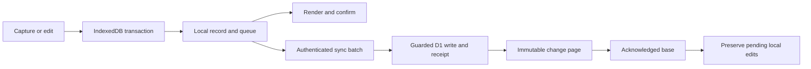

# Park

Park is a private, offline-first place to leave ideas. A compact car uses one space; a big idea uses two. A revisit date means reconsideration, never a deadline.

The implementation follows [the V4 product contract](docs/Park_App_Product_and_Implementation_Spec_V4.md). React, TypeScript, Vite, Tailwind, Dexie, Google Identity Services, a Cloudflare Worker, and D1 are the application stack. Original SVG/CSS artwork ships with the offline shell.

## GitHub Pages

Open [Park on GitHub Pages](https://simonstoryparker.github.io/park/). This version stores your park in this browser using IndexedDB. It requires no account and makes no cloud API requests. Ideas, lots, dates, completion, Undo, JSON export/import, and offline installation work locally. Use **Settings → Export backup and pending work** regularly: clearing browser storage removes local data. Move data between browsers or devices by exporting and importing a backup.

`.github/workflows/pages.yml` tests, builds, and deploys on pushes to `main`, or through **Actions → Deploy Park to GitHub Pages → Run workflow**. Repository **Settings → Pages → Source** must be **GitHub Actions**. GitHub Pages requires a public repository on the Free plan; private repositories need an eligible paid plan. See [GitHub's workflow documentation](https://docs.github.com/en/pages/getting-started-with-github-pages/using-custom-workflows-with-github-pages).

To preview this exact build locally:

```sh
npm ci
npm run build:pages
npm run preview -- --mode pages --port 4173
```

Open [localhost:4173/park/](http://localhost:4173/park/). The workflow derives the base path from GitHub Pages configuration; local builds default to `/park/`. Override `PAGES_BASE_PATH` for another project path or `/` for a custom domain. Manifest icons, service-worker scope, and assets follow this path. The regular `npm run build` and Cloudflare deployment retain Google sign-in and account sync; the two builds use separate local data namespaces.

## Run locally

Use Node 22.12 or newer and npm. The lockfile pins the dependency graph.

```sh
npm ci
cp .env.example .env.local
cp .dev.vars.example .dev.vars
npm run db:migrate
npm run build
```

Set `CURSOR_SECRET` in `.dev.vars` to a random string of at least 32 characters. For real Google sign-in, set `GOOGLE_CLIENT_ID` there, or remove the empty `GOOGLE_CLIENT_ID` line from `.dev.vars` to use the configured public ID in `wrangler.jsonc`. In the Google client, register both `http://localhost` and `http://localhost:5173` as authorized JavaScript origins. No redirect URI or client secret is needed. Park requests basic identity only.

Run these in separate terminals:

```sh
npm run worker:dev
npm run dev
```

Open [localhost:5173](http://localhost:5173). The Vite server proxies `/api` to the local Worker on port 8787. D1 remains local unless a Wrangler command explicitly includes `--remote`.

For automated/local development without Google, set `VITE_DEV_AUTH=true` in `.env.local` and `DEV_AUTH=true` in `.dev.vars`. This reveals **Use local development account** in the development server. The server accepts that identity only on `localhost` or `127.0.0.1`, with the flag explicitly enabled. The production build removes the development button, and production Worker configuration sets `DEV_AUTH=false`. Never enable development authentication on an external hostname.

## Use Park

- Type `english outline tomorrow` and press Enter. Park creates a dated lot for tomorrow and parks **english outline** inside it. More thoughts for that date reuse the lot.
- Thoughts without a date go to **Drop-off zone**, an open to-do list on the grassy landscape. It has no parking bays or enclosing card. Every parked title appears beside its left-facing car; click the title for details or tap the task car to complete and watch it drive off left. Undo restores it.
- Capture understands today, tomorrow, weekdays, ISO dates, named dates such as November 20, next week/month, and in 3 days/weeks. Dates can go at the end, or at the beginning (`tomorrow: English outline`). A leading weekday needs punctuation (`Friday: English outline`) to avoid changing titles such as Friday Night Lights. Quoted text stays literal; **Keep date in title** turns off date interpretation for a capture.
- The preview above the composer shows the destination and extracted title before saving. A draft survives refresh. `/` focuses capture; Enter parks; Shift+Enter inserts a newline.
- **+ New lot** switches the same composer to custom lot creation. For example, `post surgery for 2 weeks starting tuesday max 5`. Cancel returns to the unfinished thought. `L` opens the full lot editor with manual date and capacity options.
- Mentioning a custom lot by name routes to it unless a destination was deliberately selected. **Park here** in a lot panel chooses a destination for the next capture. The destination resets to automatic afterward unless **Remember my last destination** is enabled in Settings.
- New captures have completion enabled. Click a car in a thought’s list row to complete it, or its title to edit. In details, change Kind to Idea for open-ended thoughts. Completion and capture offer ten-second Undo.
- **Start** moves a thought to In progress, shown in the drop-off list. Dates make parked thoughts ready to revisit; they never automatically start them. Archive preserves thoughts and lots.
- The fixed shoreline has irregular coves, rocks and piers. Varied buildings and connected streets fill the land between lots. Navigation stays transparent on scroll; there is no timing dropdown or search.
- Scroll the peninsula to explore drop-off first, then custom and dated lots in chronological order. Cars and trucks share the same parking language throughout; trucks occupy two spaces. Expand a lot to read its thoughts.
- On mobile, the top-right menu contains navigation and Settings. Settings holds sync status, conflicts, backup/import, installation, sign-out, and account deletion.
- Captures commit offline before cloud sync. Two devices creating the same calendar lot converge on its shared ID; unrelated edits still require explicit conflict resolution.

## Single-line actions

Type `/` in the same composer for examples. Select an example to edit it, then press Enter. Commands show a preview; mistakes retain the draft. Names match exactly, ignoring case and normalized spaces; duplicate titles require the Action ID in details.

- `/lot Reading max 5` creates a custom lot.
- `/start "Read a book"`, `/complete "Read a book"`, `/archive "Read a book"`, `/restore "Read a book"` change lifecycle.
- `/set "Read a book" date = tomorrow` postpones; replace `date` with `title`, `notes`, `lot`, `size` or `kind` to edit that field.
- `/set-lot "Reading" capacity = 5` edits a lot; fields also include `name`, `start`, `end`, `policy`, `accent` and `slot`.
- `/archive-lot "Reading"`, `/restore-lot "Reading"`, `/keep-lot "Reading"` manage a lot; `/move-all "Reading" to "Drop-off zone"` moves its parked items atomically.
- `/lots`, `/drop-off`, `/archive`, `/settings`, `/edit "Title"`, `/edit-lot "Reading"` navigate.
- `/prefer reduced = on`, `/prefer remember = off`, `/prefer destination = Reading` set preferences.
- `/sync`, `/undo`, `/export` run utilities; `/resolve "Mutation ID" mine` or `server` reconciles an existing conflict.
- `/import`, `/sign-out`, `/delete-account` invoke the existing file selection, pending-work and account safeguards. Import preview and destructive confirmation remain required.

Quotes around an entire capture keep literal slash or date text. Commands work offline through the same local store and sync queue. A bulk move that cannot fit in a strict lot rolls back every local move; cloud sync still acknowledges individual mutations. The complete grammar and exceptions are in [spec Section 4.8](docs/Park_App_Product_and_Implementation_Spec_V4.md#48-single-line-actions-and-reduced-friction).

Current visual revision: [Fixed coastline and neighborhood verification](docs/verification/COASTAL-NEIGHBORHOOD.md). Previous Drop-off work: [Leftward completion verification](docs/verification/DROP-OFF-LANDSCAPE.md). Earlier command work: [Single-line actions verification](docs/verification/SINGLE-LINE-ACTIONS.md).

## Verification commands

```sh
npm run typecheck
npm run test:unit
npm run test:integration
npm run build
npx playwright install chromium
npm run test:e2e
npm run test:load
npm audit
```

Integration tests run the bundled Worker against actual local D1 through Miniflare. Miniflare 5's published V4 conversion adapter keeps the test setup explicit. No production credentials are used by those tests. End-to-end tests require the local development flags above and migrated local D1. Their phone project is Chromium emulation, not a physical iPhone.

Screenshots and the quota forecast are saved in `docs/verification/`. Playwright videos/traces and its HTML report are generated under `test-results/` and `playwright-report/`. See [the verification report](docs/verification/REPORT.md) for the checks actually performed and the remaining release gates.

## Durable writes and sync



Each account has a separate IndexedDB namespace. Local record changes and outgoing queue entries commit together. An acknowledged base is stored separately from pending local records. A pull page and its cursor commit together. Snapshot pages stage separately and activate only after their owner watermark stays consistent.

Mutation IDs and sent payloads stay immutable across timeouts. Same-entity changes wait for the preceding acknowledgment before taking its server version. A conflict blocks that entity and dependent lot operations; independent work proceeds. Explicit reconciliation creates a new operation against the server version. Device timestamps never decide conflict winners.

D1 triggers check strict capacity inside the mutation's transactional write, including enlargement and restoration. Entity changes, their change-log entries, and accepted idempotency receipts commit together. Reads and writes always include authenticated ownership; idea-to-lot foreign keys include the owner. General is protected locally, by API validation, and by database constraints.

Sync debounces local edits by 500ms, runs on startup/foreground, and supports manual retry. There are no requests during scrolling, rendering, or animation. Production clients send at most five mutations per request so D1 validation/receipt work stays below the Free plan's 50-query invocation ceiling. Pulls/snapshots page at 200 records. Transient retries back off from two seconds to five minutes with jitter and respect Retry-After; five consecutive failures pause automatic retry until foreground/manual sync. A verified 401 pauses sync without clearing local data.

Sessions use opaque random cookies and hashed tokens in D1, expire after 30 days, and do not slide. Google tokens are verified with `jose` against Google's keys, issuer, audience, expiry, and a single-use browser-bound nonce. Authenticated writes require the configured Origin and session CSRF token. Private API responses are never service-worker cached.

Device registrations expire after 90 days and are limited to 20 per account. Old devices require snapshot/reconciliation before their pending operations may be transferred; the client does not silently recreate old mutations under a new device ID. Metadata retention is 90 days with bounded request-triggered cleanup. Ordinary archiving never creates tombstones or deletes text.

## Back up and restore

Use **Settings → Export backup and pending work** regularly. JSON contains versioned domain records, settings, proposed edits, conflict alternatives, and persisted Undo before-images. It excludes credentials, session tokens, device IDs, cursors, and mutation receipts. Keep backups outside browser storage.

Import validates the whole file before writes and previews additions/updates. Cross-account imports get new IDs and remapped lot references; missing lot references visibly map to General. Duplicate lot names require correction. Existing-record updates are opt-in. Imported pending alternatives are retained as recoverable drafts rather than being sent as server operations.

Account-wide Replace requires a completed online sync and an empty queue. Review exact removal counts, download the automatic pre-replacement backup, then confirm. Individual operations queue durably and resume through the regular sync protocol. Strict capacity still applies. Replacement is not a single cloud transaction; other devices may temporarily see intermediate changes.

Never clear IndexedDB to resolve a sync failure. A sign-out with pending work requires syncing or exporting first. Offline sign-out clears the visible account cache but cannot revoke a remote cookie until reconnection. Remote expiry/revocation cannot erase an offline device's cache.

For a provider-level backup, use the authenticated CLI:

```sh
npx wrangler d1 export park --remote --output=park-d1-backup.sql
```

Store SQL backups privately. To rehearse recovery, create a separate empty local database/binding and import the SQL with `wrangler d1 execute <recovery-name> --local --file=park-d1-backup.sql`. Inspect ownership, counts, and sample records before considering a production restore. Do not import over live production tables without a reviewed recovery plan. Cloudflare Free D1 currently provides seven-day Time Travel; local JSON exports remain necessary.

## Cloudflare and Google setup

The authenticated setup in this workspace created one D1 database, `park`, and applied the migrations remotely. Its non-secret database/account identifiers are in `wrangler.jsonc`. No Worker has been publicly deployed and no billing change was requested.

On a new account, use:

```sh
npx wrangler login
npx wrangler d1 create park
```

Copy the resulting database ID into the `DB` binding. Replace or remove the existing `account_id` in `wrangler.jsonc` when using a different account. Keep the account on Workers Free. Do not add a payment method or accept a paid upgrade. Review existing account subscription settings in [Cloudflare](https://dash.cloudflare.com/) before release; this repository does not change subscriptions.

For Google:

1. Create/select the Park project in [Google Cloud Console](https://console.cloud.google.com/).
2. Configure Google Auth Platform branding and an External audience. Add your own test email during local verification if required by the console.
3. Create a **Web application** client in [Clients](https://console.cloud.google.com/auth/clients). Register `http://localhost`, `http://localhost:5173`, and, before deployment, the exact HTTPS production origin.
4. Use only `openid`, `email`, and `profile`. Copy the public client ID into `GOOGLE_CLIENT_ID`. Do not create or share a client secret for this flow.
5. Before inviting others, finish branding/privacy-policy requirements and publish the OAuth audience as appropriate. Verify two actual accounts, session expiry, and cross-device convergence.

These values follow [Google's GIS setup guide](https://developers.google.com/identity/gsi/web/guides/get-google-api-clientid). Interactive account creation, consent, and browser sign-in must be completed by the user; automated browser control is not used for provider setup.

## Deployment, after the release gates

Set `APP_ORIGIN` to the intended HTTPS `workers.dev` origin. Set the actual Google client ID and keep `DEV_AUTH=false`. Generate and upload a production-only cursor secret:

```sh
openssl rand -base64 48 | npx wrangler secret put CURSOR_SECRET
npx wrangler d1 migrations apply park --remote
npm run build
npx wrangler deploy --dry-run
```

After approving release and registering the HTTPS origin with Google:

```sh
npm run deploy
```

Static assets use Workers Static Assets. Only `/api/*` invokes the Worker first; the shell uses SPA fallback and stays usable when the API fails. The PWA manifest includes 192px/512px icons. Install/reopen and software-keyboard behavior must be checked on a physical iPhone, separately in Safari and the installed PWA.

Account deletion requires export, fresh Google authentication within five minutes, and typing DELETE. It disables the user, revokes sessions, and deletes records in bounded chunks. A short-lived deletion-status credential allows cleanup to continue after normal sessions are revoked. Google linkage is removed before completion is reported. The progress screen resumes cleanup after reload; if its short-lived credential expires, fresh Google authentication can resume deletion without reopening normal access. Progress requests advance cleanup immediately. An hourly scheduled sweep also advances up to two unfinished jobs in bounded chunks, even after their browser credentials expire. Large deletions may span multiple runs.

## Free-tier limits and monitoring

The forecast is deliberately conservative. The local harness executes 100 account fixtures and 500 idea inserts, measures local D1 row reads/writes and wall time, and projects daily workloads for 100, 1,000, and 10,000 active accounts. Larger figures are forecasts, not measured user capacity or production load tests. Worker CPU time still needs deployed measurements.

Planning ceilings, checked against the provider documentation: 100,000 Worker requests/day; 10ms CPU/request on Free; D1 5,000,000 rows read/day, 100,000 rows written/day, 500MB/database, 10 databases and 5GB total/account. Index writes count toward D1 usage. A quota failure preserves the local queue; it does not upgrade the plan.

Sources: [Workers limits](https://developers.cloudflare.com/workers/platform/limits/), [D1 pricing](https://developers.cloudflare.com/d1/platform/pricing/), [D1 limits](https://developers.cloudflare.com/d1/platform/limits/).

Use the Cloudflare dashboard's Workers metrics and D1 Analytics/Storage before invitations and after traffic changes. Review requests, CPU, errors, row reads/writes, and database size. Use available free notifications without enabling paid services. At 60%, 80%, and 90% of a daily/storage ceiling, investigate batching/indexes and pause invitations; do not promise unlimited service. Provider alert availability and production measurements remain release checks.

Fair-use guards currently allow 120 authenticated API requests/minute/account and 20 login/challenge requests/minute/IP. Requests are limited to 256KiB, records have bounded text fields, capacities are 1–99, and devices are limited per account. Provider/WAF controls may be needed if measured abuse exceeds those limits.

If storage becomes limiting: export D1; rehearse a restore; introduce an owner-to-database routing adapter; migrate whole owners to another D1 database; verify counts/checksums and sync watermarks; cut over with a rollback window. Keep ownership guards and the existing protocol. More databases do not increase the account-wide Worker or daily D1 quotas. Re-evaluate another provider only with a separate migration plan and explicit cost approval.

## Design and motion decisions

Park's parking metaphor supplies the interaction and the visual identity. Blue water `#1685b7`, varied green terrain `#8ba35e`, sand `#ddc790`, and dark green interface text form the coastal palette. Functional type uses the system UI family with selectable text; only `park.` uses the locally bundled Press Start 2P pixel font. Spacing follows a 4px grid; controls use modest 5–12px corner radii. Sparse offices and trees use deterministic variation and never represent records.

Capture motion is save feedback and spatial orientation: an SVG arrow morphs through intermediate geometry, then a noninteractive WAAPI layer travels for up to 900ms using measured lot/lane geometry. The input is reusable after the local commit. The reserved static sprite is hidden only during that journey; counts always derive from stored records. Resize, scrolling, Undo, or animation errors cancel the effect and restore static rendering. Offscreen/unrepresented targets use the named confirmation. Reduced motion skips travel; completion drive-off lasts 280ms.

The spec's exact design, SVG-art requirement, and capture timing override generic skill defaults about dealt palettes, raster imagery, and short/frequent motion. The doc-coauthoring workflow is applied as a clarity/review pass; the spec explicitly authorizes continuous implementation without repeated approval stages.
