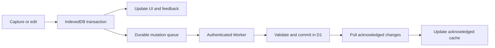
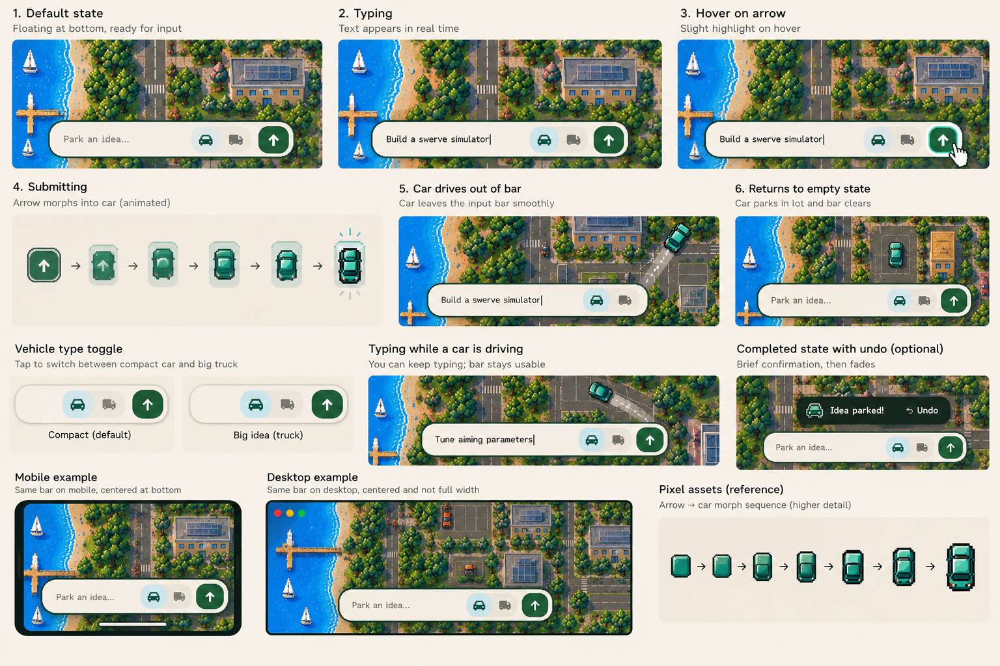
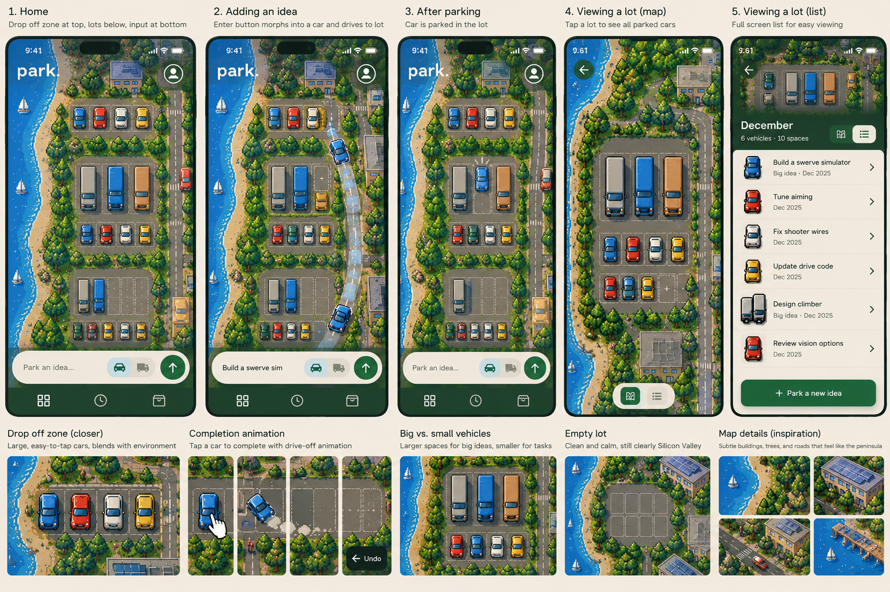
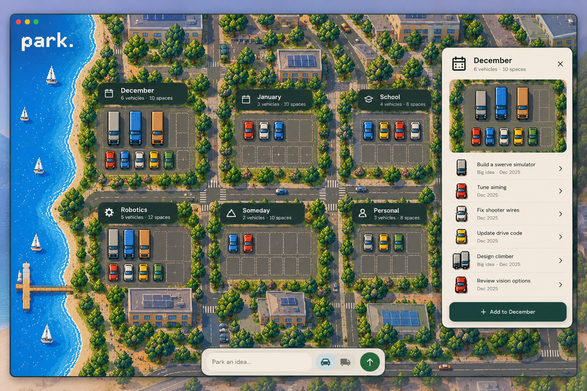
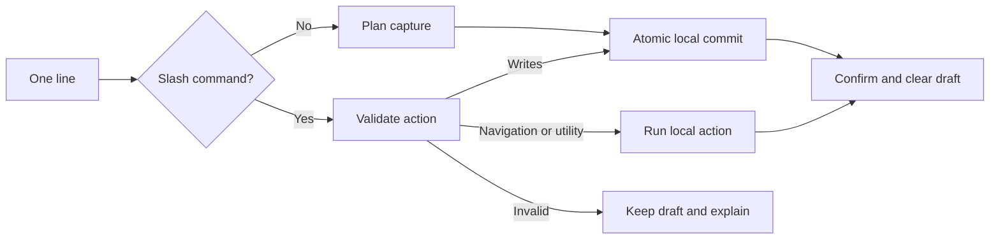

# Parker — Product & Implementation Specification

**Version:** 4.7 — fixed irregular coastline, neighborhood scenery, and simplified navigation

**Updated:** October 27, 2026<br>
**Platform:** iPhone-first progressive web app (PWA), also comfortable on a Mac  
**Budget:** $0 for development, deployment and operation **within current free-tier limits**; no payment method or automatic paid upgrade  
**Status:** Implementation contract; production credentials, deployment, and physical-device verification are external release prerequisites.

## 0. Agent handoff

Build Parker end to end from this document. The repository contains the React app, Worker, D1 migrations, tests, and operating instructions. Extend the existing implementation and preserve stored data. Preserve the product scope in Section 11. Complete the implementation and runnable local verification in one continuous pass; the phases in Section 12 are execution order, not requests to stop for approval.

- **Authority:** This revision supersedes earlier Parker specs. Requirements and acceptance criteria are binding; examples and the suggested file layout are illustrative. Apply repository/user instructions first. When a generic skill conflicts with an explicit Parker behavior, follow Parker and record the exception.
- **Decision ownership:** Make ordinary implementation choices, document them briefly, and continue. Do not add product features or change the stack. Ask only when a missing answer would change user-visible behavior or require unavailable credentials/access; finish independent work while waiting.
- **External setup:** Production requires a Google web client ID and allowed origins, a Cloudflare Free account, a D1 binding, and deployed HTTPS URLs. Read available configuration without printing secrets. Provide `.env.example` and precise setup commands; never fabricate credentials or silently substitute development auth in production.
- **CLI-first setup:** Attempt external-service setup with supported CLI tools and existing authenticated sessions first (for example, Wrangler for Cloudflare resources, bindings, migrations, and deployment configuration). Inspect available tooling and permissions, then perform supported setup within the authorized scope and Free-plan constraints. Do not merely give the user commands the agent can run itself.
- **Manual browser handoff:** When setup requires browser-only configuration, account creation, sign-in, consent, or another human action, have the user complete it in their own browser. Provide the direct page link, exact steps/values, and the non-secret result needed to continue. For CLI login, start the supported login flow and let the user finish its browser prompt. Never use screen sharing, remote desktop, computer-use tools, or automated takeover of the user’s browser for external-service setup. After identifying a CLI limitation, hand off the necessary manual step promptly rather than repeatedly trying UI workarounds; continue independent implementation while waiting, then resume CLI setup and verify the result. This restriction does not prevent automated tests of Parker itself.
- **Verification:** Use the gates in Sections 12–13. Report each as passed, failed, or not run, with evidence. Browser emulation does not satisfy actual iPhone/PWA or production OAuth checks. Do not claim deployment, security assurance, or measured user capacity from a local mock.
- **Deliverables:** Working source and lockfile; local/production configuration; validated D1 migrations; automated checks; representative screenshots; a README covering setup, scripts, backup/restore, deployment, and quota limits; a concise completion report identifying external checks still required.

Read Sections 2, 6–9 for domain and persistence rules, Sections 3–5 for UI behavior, then Sections 11–14 for scope and completion. Keep domain rules shared between client and server.



Network failure leaves local work and the queue intact. Animation starts only after the local transaction commits.

## 1. Product vision

**Parker is a place to leave ideas without turning them into commitments.** Capture an idea, see it enter a recognizable parking lot, and return to it when ready. Dates mean reconsideration, never deadlines.

The visual identity combines the top-down pixel-art language of **Xevious (1983)** with **1990s Silicon Valley**, especially Palo Alto and Mountain View: a small Peninsula world with modern iPhone usability. Sections 4.6–4.7 define the shared art direction, responsive desktop behavior, and how to use the concept images.

The parking metaphor drives behavior: an idea is a car, a lot holds parked cars, parking confirms a save, and pulling out deliberately makes an idea Active. Archive preserves history without a failure metaphor.

### Non-negotiable principles

1. **Capture first:** Only text is required; save with one submission. Lot/date/size choices remain optional.
2. **Functional metaphor:** Miniature lots show occupancy and empty spaces. Capacity affects parking; motion confirms where an idea went.
3. **Local trust:** Commit locally before success feedback. Preserve offline edits, disclose pending/failed sync, and support export/import.
4. **Personal and private:** Google accounts and cross-device sync are V1 requirements. Cached capture/editing work offline after first login.
5. **Calm interaction:** No overdue states, guilt, streaks, or automatic activation. Animation never delays the next capture.
6. **Free operation:** Use no paid services or external AI APIs. Minimize requests and storage; quota exhaustion must preserve local work.

## 2. Core model and terminology

### Accounts and ownership (required in V1)

- Each user signs in to their **own free Parker account** using **Continue with Google**. The Google identity scopes are limited to `openid`, `email`, `profile`. Do not ask for access to Drive, Calendar, or other Google data.
- No passwords are collected, stored, or hashed by Parker. **Do not implement homemade password authentication.** An alternative email/password provider may be added in a later release only if it remains free and secure.
- Accounts own independent private ideas and lots. No shared lots, public profiles, or social feed in V1. A user must never be able to read or edit another user's records by guessing a UUID.
- An account has one private built-in **General** lot. All records are scoped to the authenticated user on the server and in the local cache.
- Initial Google login and first-device sync need internet. After a successful login, previously cached account data supports offline use. Logging in to a *new* device always requires internet.
- Sign-out must not expose locally cached private data to the next user. If edits are not yet synchronized, block destructive cache clearing and offer **Sync first / Export pending work / Cancel sign-out**.
- Display the account email/avatar in Settings, allow explicit sign-out, account/data export, and account deletion. Do not expose the email in URLs or analytics.

### Ideas

Each idea is one stored item and has one lifecycle state:

- **Parked:** Sitting in a lot, including items that are eligible to revisit.
- **Active:** Intentionally pulled out to work on now; not occupying a parking space.
- **Archived:** Finished, dismissed, or kept for reference; not occupying a parking space.

Each idea belongs to exactly **one lot** in V1. The built-in **General** lot is the default destination, so no lot decision is ever required to save. General is unlimited and cannot be deleted. **Someday** describes effective-undated items; it is not a separate stored lot, required folder, or visible timing filter. Display grouping must not duplicate records or add to occupancy.

Vehicle size and completion intent are independent. Add `kind: idea | task`, defaulting to `task` for new captures so its car can be completed immediately; the details sheet and `/set "Title" kind = idea` let the user change it. Existing records retain their kind. Only `task` records offer **Complete**, regardless of compact/truck size. This is a fixed capture default, never an inference from text, size, or date. Do not add a required choice during capture.

An idea can have an optional personal **revisit date**. It may also inherit a not-before date from its lot. The original idea text is preserved even if a recognized time phrase is removed from the display title.

### Lots

A lot is a named container with independent, optional settings:

- **Name** (required; e.g., Robotics, December Projects, Post Surgery)
- **Start date** (optional; the beginning of the period for which the lot is intended)
- **End date or duration** (optional; the last day of that period)
- **Capacity** (optional; e.g., 5 spaces; unlimited by default)
- **Capacity policy** (optional: **soft** by default; **strict** only when deliberately enabled)
- **Visual accent** (optional color/car style; automatic default)

The combinations are deliberately flexible:

| Example | Lot type | Behavior |
| --- | --- | --- |
| Robotics | Permanent, unlimited | Always available |
| winter break | Future-starting, optionally ending | Can collect ideas now; becomes ready to revisit when its period starts |
| Post Surgery, 2 weeks starting Tuesday | Temporary | Scheduled before Tuesday, open during the 14-day window, ended afterward |
| Side Projects, max 3 | Capacity-constrained | Show 3 parking spots; explain when full |
| December Experiments, max 4 | Time-bound + capacity-constrained | Both dimensions work together |

**Do not force users to choose a lot type.** Every lot uses the same optional fields.

### Lot timing and archive state

- **Upcoming:** Start date is in the future. You may park ideas in it *before* it starts.
- **Open:** It has started and its end has not passed, or it has no applicable time restriction.
- **Ended:** Its window is finished; ideas stay safe and visible, and the app offers review options.
- **Archived (independent of timing):** Hide the lot and its Parked ideas from normal Lots, Someday, Ready, and ended-lot prompts. Keep them accessible in Archive. Active ideas remain in Now. Unarchiving recalculates readiness; never change item status or delete data merely because its lot is archived.

Do not automatically archive, move, start, or delete ideas because a lot ends. An ended lot remains readable. New parking into it should prompt to extend/reopen it or choose another lot; never silently place a new idea in an ended lot.

### When an idea becomes ready

For a parked idea, define its **effective not-before date** as the **later of** its own `revisitOn` and its lot's `startOn` (ignoring missing values). If both are absent, the idea is **Someday** and does not resurface automatically.

- When the effective date arrives and the lot is not archived, show the item in **Now → Ready to revisit**; its status remains **Parked** and it still occupies a space.
- A future lot start makes its parked ideas eligible for review **by default**, without copying that date into every item.
- An item with its own later revisit date waits until that date even if the lot starts earlier.
- Editing a lot's start date recalculates eligibility automatically; it does not rewrite each item's personal date.
- If a lot ends before an item's individual revisit date, preserve that item's date. The lot gets an **ended-lot review prompt**, but the item must not be forcibly activated or silently rescheduled.
- A permanent lot without a start date does *not* automatically surface undated ideas.

An **end date is not a due date**. It closes the intended *period of the lot* and prompts a gentle review on app use; it does not impose completion requirements.

## 3. Primary information architecture

Use three primary destinations and a Settings panel:

**Lots (default home)**

- **Pinned bottom quick-capture composer** with navigation in the top-right popover; never place the primary capture bar at the top.
- The Drop-off is an open to-do list on the grass, listing **every Parked item assigned to General**, with a left-facing car on the left and its readable title beside it. It has no miniature, parking bays, duplicate car summary, or enclosing white/cream rectangle. No cap or expansion is required to read titles. The list grows in normal map scrolling; later row bands move down to prevent overlap. User-created lots remain collapsible visual parking lots.
- Each lot header shows name, timing (if any), occupancy/capacity (if any), and a subtle upcoming/open/ended label.
- Mobile collapsed: a compact overhead parking lot illustration with car positions; expanded: accessible idea rows/cards with actions.
- Desktop: labeled lots in a generated landscape; selecting one opens a floating lot panel with the same readable rows/actions (Section 4.7).
- General always exists and is the default parking destination.
- Create Lot is reachable with one tap and through desktop keyboard shortcuts.
- No All ideas/timing dropdown, search icon, search field, or floating finder. Browse the actual lots and item lists; named `/edit` and `/edit-lot` commands remain direct entry points.

**Drop-off zone (also referred to as Now in the scheduling model)**

- **Drop-off zone** is the user-facing name for built-in General and the full-list destination. Show General’s Parked items, then **Ready to revisit** from other non-archived lots, then **In progress** (Active items from any lot). Each item appears once within this destination. Drop-off is a presentation name, not another stored entity or lifecycle state. Task vehicles complete; idea vehicles open details; title clicks always open details.
- **Active** items deliberately pulled out to work on.
- **Ready to revisit** parked cars whose effective date has arrived; actions: Start, Later, Move, Archive.
- Non-urgent prompt to review lots whose window ended. No overdue count.
- Quick capture remains available here too.

The home Drop-off list repeats General’s Parked records for convenience; it never creates records or adds occupancy. Ready excludes General here because those items already appear in its first section. Active is disjoint from Parked. **Someday** is a timing description for effective-undated Parked items, without a filter control or a separate stored/visual lot. Order lots as General first, undated custom lots next, then dated lots by ascending start date; tie-break on `sortOrder`, then ID. Order Active by newest `activatedAt`, Ready by earliest effective date then `createdAt`, and other item lists by newest `createdAt`, with ID as final tie-breaker.

**Archive**

- Archived items plus archived lots and their contents, ordered newest first. Restore/move supported. No search control.

**Settings**

- Signed-in Google account, sync health (`Synced`, `Changes waiting`, `Offline`, `Unable to sync`), sign-out, export/import, deletion, reduced motion, installation instructions, optional default lot preference.
- Make privacy and data ownership clear: cloud copy is private to the account, local edits work offline, server free tiers have usage ceilings.

Mobile folds Lots / Drop-off zone / Archive / Settings into the top-right navigation popover. The bottom contains one pinned composer, respecting iOS safe areas. When the software keyboard appears, keep the composer above the keyboard and hide or compress navigation; never let it cover the input. Desktop uses the landscape and compact navigation controls, with no permanent sidebar; preserve keyboard shortcuts and access to every destination (Section 4.7). Avoid adding another dashboard merely to display counts.

## 4. Main screen details

### 4.1 Collapsed lot view: an actual tiny parking lot

A collapsed user-created lot is a **readable, compact top-down pixel-art parking illustration**, following Section 4.6. General is the explicit exception: render it as the open Drop-off list in Section 4.5. Render with ordinary HTML/CSS and inline SVG on a shared logical pixel grid; bundle any supporting assets locally. The component must:

- Show a **header** with lot name, time-window label, and `occupied / capacity` when limited.
- Show **distinct parking spaces** and a recognizable pixel-art compact car or truck for every parked item represented.
- Show **empty spaces** when the lot has a capacity; occupancy must match the sum of parking-space units used by **Parked** items, including Ready items.
- Handle unlimited user lots with the same top-down lot design. Fit visible cars by reducing *visual scale* as count grows, while maintaining compact/truck relative size. Use a minimum legible visual scale, then bounded preview plus `+N cars`; never imply a maximum. The count in the header remains authoritative.
- For limited lots with many spaces, scale the drawing to the available width until a legibility threshold, then render a bounded preview (e.g., 6–8 spaces) and a clear `+N more` indicator. Never hide the true total or imply all spaces are visible.
- Clearly distinguish an empty lot, available capacity, at-capacity, and over-capacity. Do not use red shame signaling.
- Be tappable/clickable to expand. Keyboard and screen-reader users should get a text label like “Post Surgery, 3 of 5 spaces occupied, opens Tuesday, expand.”
- Avoid visual clutter, 3D graphics, and intricate individual-car interactions in V1.

The miniature lot does not need to allow dragging cars into spots. **Cars are a visual summary; idea cards are the primary editing surface.**

### 4.2 Expanded lot view

On mobile, selecting a lot expands a list of its parked ideas. On desktop, selecting its map plot or label opens that list in a floating panel (Section 4.7). Show each item's title and concise timing (“Not before December,” “Ready to revisit,” “Someday”). Actions: **Start**, **Later**, **Move**, **Edit**, **Archive**. A subtle car glyph may appear on a card, but text takes priority. Ended-lot controls: **Extend**, **Move ideas**, **Keep as is**, **Archive lot**.

Keep large touch targets and comfortable scrolling. On desktop, support keyboard navigation and Enter to open the lot panel, with Escape to close and focus returned to the originating lot. Preserve the expanded/collapsed state while navigating during a session; optionally store preference locally.

### 4.3 Quick capture

**Happy path:** open → type → Enter (or Parker) → done. No required extra step.

- Automatic destination: a deliberately selected lot first, otherwise the longest matching custom lot name, otherwise create/reuse a calendar lot for the parsed revisit date, otherwise **General / Drop-off zone**. Remember last-used destination only as an opt-in setting. Calendar IDs are deterministic (`date-{precision}-{ISO date}`), shared across devices. Reuse reopens an archived calendar lot; a different archived custom lot is never silently reopened.
- Show the selected or inferred destination above the writing bar while there is text or an explicit destination. Reset returns to automatic routing; Park here in a lot panel selects that lot. The idle composer is one line with no extra hint row.
- Suggest an existing lot when the text confidently matches its name, but **never silently override a deliberate lot selection**.
- If there is no explicit date, an idea in a future lot inherits the lot's start date for eligibility; in a permanent lot it is Someday.
- Show the extracted title and date destination before saving. Keep date in title preserves the literal phrase; quoting the full capture also preserves it. A confident date creates or reuses a date lot atomically with the captured item and queue entries.
- Desktop: use the same compact floating composer at the bottom center of the window, with bounded width rather than a full-width input. Retain the destination, vehicle-size controls, and Parker interaction. Enter parks; Shift+Enter inserts a newline; `/` focuses the composer when not typing; Escape closes menus/panels.
- Mobile: a persistent **bottom-anchored writing bar**, with a nearby 1-tap **Compact / Big idea** toggle (car/truck), destination chip, and morphing Enter/Parker button, all reachable above the keyboard.
- Vehicle size defaults to **Compact** until explicitly switched, so capturing stays one action. Toggle before saving; after saving use `/set "Title" size = big` or the details sheet. Do not add a size button to every row. The submit control uses a crisp pixel-art upward arrow from the same grid/palette as the vehicles, with accessible name **Park idea**; avoid a visually unrelated stock icon. Pointer hover may add a subtle highlight on devices that support hover; keyboard focus and touch pressed states provide equivalent feedback.
- Immediately return focus after a successful save, ready for the next idea.
- Confirm with quiet feedback (“Parked in Robotics · Undo”). Capture Undo is available for 10 seconds and archives the newly created idea with reason `dismissed`; it never hard-deletes text. Use a normal compensating mutation and preserve later edits if they conflict.

**When something goes wrong:** If **local persistence** fails, retain the draft and show an actionable error; never play a fake success animation. If local storage succeeds but the server is unreachable, the idea is safely **parked on this device, waiting to sync**. Never say it has synced until the server acknowledges it.

### 4.4 Capture morph and routed parking animation (core V1)

**Reference:** The [capture-bar blueprint](references/retro-pixel-parking-app-ux-blueprint.png) illustrates pixel styling and the transformation/journey/arrival sequence. Exact frames, dimensions, hover effects, dashed trails, sparkles, and captions are illustrative. Written behavior takes precedence: clear the submitted draft and restore the composer after local commit, not after the car arrives. Capture Undo remains required by Section 4.3 even though the image calls it optional.

#### Successful submission

1. Snapshot the submitted text, destination lot ID, vehicle size, and submit-button rectangle for this submission. Commit the idea and outgoing mutation together in account-scoped IndexedDB. On failure, retain the draft and show an error; do not morph or drive.
2. After commit, update occupancy and clear only the submitted draft. Preserve any newer typing. Keep focus in the composer and immediately restore a usable arrow button; neither the morph nor the journey disables subsequent input/submission. Show the text confirmation and Undo immediately after commit; the ten-second Undo window starts then.
3. At the button’s exact screen position, its pixel-art visual surface continuously transforms into the selected top-down compact car or truck. Show intermediate shape changes that connect arrow/button to vehicle; an abrupt icon replacement or crossfade alone is insufficient. Use a transient visual layer matched to the button’s bounds so the real semantic button can remain usable. The input text/card never becomes the car.
4. The vehicle leaves the bar, joins the visible road/side lane, and drives toward **this idea’s actual lot**. Derive the path from current road connections, lot entrance, and parking geometry. Use turns and heading changes that follow the route, then align the vehicle with its assigned visible space. For General, the target is the actual left-facing car beside the new Drop-off title; it has no parking bay or capacity illustration. Do not use one arbitrary path for every lot or fly directly across buildings/water when a visible road route exists.
5. For a visible, represented destination, show the vehicle entering its reserved visual space, then hand off to the static parked vehicle and briefly highlight the lot. Arrival adds visual feedback only; it does not repeat the local-save announcement or restart Undo. Keep pending/synced status separate. Driving is feedback for a completed local save, not another lifecycle state or cloud acknowledgement.

#### Route, rendering, and interruption contract

- **Shared geometry:** The renderer exposes a local route description: coordinate transform, visible road/lane segments and connections, lot entrance, target-space rectangle/orientation, and a layout revision. The desktop landscape generator supplies real scene geometry (Section 4.7); mobile uses its rendered lots and edge lane. Route in a common coordinate space and convert to the overlay/viewport correctly. No external maps, physics engine, traffic simulation, or network routing is required.
- **Arrival target:** Reserve the new idea’s visual placement from the post-save layout; a truck needs its two-unit footprint. During visible arrival, suppress only that idea’s static sprite to avoid duplication; occupancy/counts remain correct throughout. Always restore rendering from current stored state on arrival, cancellation, Undo, or animation failure. Do not persist visual spot reservations or use them to enforce domain capacity.
- **Unavailable/overflow destination:** If the lot is offscreen, collapsed without usable target geometry, hidden by a panel, or omitted by a bounded preview, drive along a visible lane toward the appropriate road exit when a meaningful route is available, then confirm the named destination. Otherwise use a visible destination chip/lot highlight with a brief fade, or just the named text confirmation if no destination target is visible. A soft-over-capacity arrival may use a represented overflow position or this fallback; never invent an empty capacity space. No animation may scroll, pan, zoom, or move the camera to chase a car.
- **Layout changes:** Resolve geometry at animation start. Validate the captured origin against the current layout; if keyboard/viewport changes during the commit made it stale, remeasure the button or use the fallback. If scrolling, keyboard/viewport changes, rearrangement, or navigation invalidates it, safely recompute the remaining visible route or finish with the fallback; do not jump to stale coordinates or restart endlessly. The stored idea remains unaffected.
- **Concurrency:** Each animation retains its submission’s lot/vehicle/idea identity; later edits to the composer must not retarget an earlier car. Two deliberate submissions create two records; duplicate handling of one submission creates one. Cap simultaneous decorative journeys (two is sufficient); additional captures receive immediate confirmation without waiting in an animation queue. Cancel an idea’s in-flight effect on Undo and derive its display from the resulting local state.
- **Timing and technique:** Aim for roughly **450–900 ms** for morph + visible route + arrival, with an upper bound of **1,200 ms** for a longer route. Keep turns legible and speed changes smooth; use the exit fallback rather than a long offscreen journey. Prefer Web Animations API/CSS transforms and opacity for travel, with a lightweight SVG shape sequence for the morph. Use shared grid-aligned vehicle artwork and smooth translation/rotation; pixel art does not require choppy timing. Do not add a heavy motion library solely for this effect.
- **Accessibility/reliability:** Reduced motion replaces morph/travel with an immediate state update or brief opacity transition and the same text confirmation. Keep the visual layer noninteractive and hidden from assistive technology; the input/button retain focus and labels. Animation exceptions, route failures, unmounts, and server outages never roll back or duplicate the saved idea. Parker works equally through pointer, touch, and Enter. Parker’s explicit morph/journey and timing requirements take precedence over generic motion-skill limits.

**Definition of success:** Transformation, visible journey, and parking read as one coherent action while the next capture is already available.



### 4.5 Thumb-first layout and front-end design bar (core V1)

**Information above, actions below:** On mobile, scrollable content consists of the **Drop-off zone** near the top, then collapsible top-down **parking lots**. The persistent bottom action rail contains one composer; navigation stays in the top-right popover. Desktop uses the generated landscape, floating composer, and panels in Section 4.7; it does not stretch this mobile rail across the window. The rail respects `env(safe-area-inset-bottom)` and mobile viewport changes; on iOS when the keyboard opens, preserve visibility of the composer and keep navigation out of the keyboard area. Avoid obscuring focused text and avoid an enormous permanent footer.

**Drop-off zone interaction:** Only rows with `kind: task` have a completion button. The home Drop-off is a to-do list placed directly on the grassy landscape, above the dated lots. It is neither a parking lot nor a white/cream rectangular card: no miniature bays, duplicate cars, or enclosing panel. Every General Parked item appears once, newest first, with a left-facing car or truck on the left and its readable title beside it. Give the car a minimum 44×44px hit target, preserve long-title wrapping, and grow the clearing before positioning subsequent lots. **Tap the car** to mark the task complete (archive with reason `completed`), then animate that exact car **driving off the left edge of the viewport** and show a short **Undo** action; **tap the title/row text** to open details instead. These must be distinct hit areas and screen-reader actions. For `kind: idea`, tapping its vehicle opens details and never completes it. An explicitly marked task can be completed at either vehicle size. If a parked-ready item is completed, its parking capacity is released; if the item was Active, it was already excluded from occupancy. Snapshot the tapped vehicle’s artwork, orientation, and viewport bounds before local persistence removes the row. Animate only after a successful local transaction and queue the synced change. Use a noninteractive, assistive-technology-hidden overlay, translating left for 280ms with the shared strong ease-out curve. The remaining rows update immediately. Undo, navigation, scrolling, viewport resize, and unmount remove the overlay; reduced motion uses the same completion and Undo without travel. Animation failure never rolls back the saved completion. Undo remains available for 10 seconds, with its before-image and expiry persisted locally. It queues a compensating mutation even if completion has synced. Undo restores only the prior lifecycle fields (`status`, `activatedAt`, `archivedAt`, `archiveReason`) subject to current lot/capacity rules; if restoration is blocked, retain the before-image in Needs attention and offer destination/limit choices. Do not overwrite subsequent edits; offer explicit conflict resolution. After expiry, ordinary Restore remains available in Archive.

**Vehicle semantics:** Capture has a keyboard-accessible `Compact` / `Big idea` selector; existing items expose size in details and the single-line command. Compact = 1 parking-space unit, truck = 2 *adjacent* units in a conceptual grid. Adjacency is visual only: repack the miniature on changes, allow a truck to span a row, and never reject parking because a decorative grid is fragmented. Capacity is determined solely by total space units. This is a **visual/capacity size**, not a priority, estimate, or deadline. Changing size on an already parked idea immediately updates capacity; apply strict-capacity checks on device and server. If a strict lot cannot fit a newly enlarged truck, do not lose the idea: show an option to keep compact, move lots, or change capacity. Trucks and compact cars stay visually distinguishable at every zoom level. A one-space remainder cannot physically fit a two-space truck even if car-count limit would appear available.

**Renderer:** Section 4.1 defines the shared miniature renderer. Scale the whole drawing, preserve compact/truck proportions, and use accurate vehicle/space counts when a preview is bounded. Miniature cars are decorative; expanded rows provide individual actions.

**Minimal, non-generic visual language:** One readable UI font family, with the pixelated `parker.` wordmark as the sole typography exception; documented spacing/color/radius tokens, restrained accents, consistent hierarchy. No greeting paragraphs, AI-generated inspirational copy, productivity scores, filler subheadings, card-within-card dashboards, random decorative icons, gratuitous gradients, fake content, or unnecessary badges. The parking illustrations and movement carry the app's character. Labels are brief: `Lots`, `Ready`, `Someday`, `Big idea`, `Parker`, `Undo`. Prefer whitespace and typographic hierarchy over repeated containers.

**Apple-inspired interaction principles:** Place frequent actions in natural thumb reach; separate navigation from content; preserve familiar menu behavior and comfortable touch targets (~44×44pt); let contextual actions appear near their object; apply motion only to communicate state. Do not imitate Liquid Glass unnecessarily in a web app. Respect reduced motion, keyboard navigation, safe areas, screen readers, and focus. Avoid relying on hover or color alone.

**Front-end acceptance process:** Self-review one exemplary mobile home screen before adding routes. Use the screenshot/device matrix in Section 13; fix overflow/alignment and retain visual baselines. Remove filler copy and unrelated decoration; retain the coastal environmental cues required by Section 4.6. Capture must be understandable without a tutorial paragraph.

### 4.6 Visual direction: coastal Silicon Valley in pixel art

**Design goal:** Parker feels like a carefully crafted 1990s Silicon Valley world seen through a classic top-down arcade game. Pixel art supplies its character; modern controls keep capture, reading, and editing simple.

**Reference and precedence:** The [concept montage](references/pixel-coastal-task-manager-montage.png) is the primary visual target for atmosphere, palette, perspective, artwork, and composition: match the drawings as closely as practical while keeping the interface usable. The explicit Drop-off list and leftward completion requirements in Section 4.5 supersede the montage’s pictorial Drop-off parking lot. Functional behavior and accessibility still follow this written specification. Adapt dimensions and spacing for real text and viewport sizes without replacing the coastal world with generic cards. Mockup captions, sample text/dates/counts, and depicted controls do not add requirements.

- **World and palette:** Use blue water and a restrained coastline along the left edge of the Lots scene, with low-rise offices, paved lots, tree-lined streets, and understated 1990s suburban architecture. Use richer layered pixel foliage, tree-lined plot edges, shaded vehicles, asphalt bays, and a blue shoreline to approach the drawings. Keep a clear grassy area behind the Drop-off list and exclude the entire tree canopy from text and controls. Cluster scenery in the remaining land instead of scattering it over content. Use a shared palette of water blues, greens, asphalt/building neutrals, light readable surfaces, and a few vehicle accents. Define exact color tokens during implementation and verify contrast.
- **Pixel-art system:** Lots, compact cars, trucks, roads, buildings, trees, and shoreline share one top-down perspective, logical pixel grid, outline weight, palette, and lighting direction. Use crisp stepped shapes and restrained shading; avoid mixing painterly terrain, smooth vector cars, and unrelated icons. Xevious informs the visual language, not combat, scoring, or gameplay. Create original Parker artwork rather than reproducing game assets.
- **Brand and text:** Display the wordmark as lowercase **`parker.`**, including the period, in distinctive pixel lettering. A locally bundled pixel font or custom grid-based SVG lettering is acceptable; give an SVG wordmark the accessible name “Parker.” Use the readable UI family for all idea text, labels, dates, menus, and inputs. Never rasterize functional text or use a pixel font for body copy.
- **Integrated controls:** Carry the scene’s colors, vehicle motifs, and restrained edge treatment into the composer, buttons, chips, navigation, menus, and sheets. Keep familiar control behavior and clear focus/pressed/disabled states. Use calm opaque surfaces for individual buttons, menus, panels and the composer; the navigation wrapper stays transparent at every scroll position. Never add a full-width opaque header on scroll. Keep the Drop-off list directly on quiet grass, with scenery excluded from readable content. Pixel styling must not shrink hit areas or force every control into a rigid square shape.
- **Responsive restraint:** Lots are data-driven; surrounding scenery is decorative. Mobile keeps the compact scrolling lot presentation. Desktop generates the navigable landscape in Section 4.7. On narrow screens or at large text sizes, simplify the coastal margin and scenery before reducing usable content width, and use the mobile presentation when desktop panels no longer fit. The images alone do not require a map/list toggle or extra route.
- **Function and motion:** Preserve the Lots/Drop-off zone/Archive structure, readable Drop-off rows, bottom composer, capacity counts, and interactions in Sections 3–4.5. Decorative buildings, trees, boats, and roads never represent ideas or add tappable objects; only domain records determine occupancy. The montage’s pictorial drop-off does not replace the readable list or expand task-only completion. Animate only the specified user feedback; no ambient scrolling terrain, blinking scenery, or continuous water effects in V1.
- **Implementation:** Use shared CSS/SVG components and grid-based art tokens rather than a screenshot background. Preserve crisp edges as the whole miniature scales; at small sizes, simplify detail and use the bounded-preview rule in Section 4.1 instead of rendering unreadable pixels. Bundle scene assets with the offline shell; no runtime image/font fetches or game engine. The reference PNG is documentation, not a production UI asset.



### 4.7 Desktop: generated Peninsula landscape and floating panels

**Design goal:** Use the wider viewport to explore a small pixel-art Silicon Valley peninsula. Extend the mobile visual identity and product rules through a spatial desktop layout; do not enlarge the phone screen or use a static dashboard background.

**Reference and precedence:** The [desktop concept](references/pixel-park-map-dashboard.png) establishes the water/land composition, compact centered composer, labeled lots, and floating inspector. Its exact buildings, lot arrangement, icons, counts, and panel dimensions are illustrative. Written behavior and accessibility requirements take precedence. In particular, the mockup’s **Someday** plot does not create a stored lot or duplicate parked ideas: Someday remains the alternate grouping defined in Section 3.

#### Layout and navigation

- Keep blue water/coastline as a stable visual anchor along the left side; developed land extends to the right. Place the pixelated **`parker.`** wordmark at the upper-left coastal edge rather than in a traditional header. It stays white with a subtle dark edge for legibility over land or water; never reshape the coastline to follow it while scrolling. On a constrained viewport, simplify this margin instead of squeezing functional content.
- Arrange lots across land with roads/gutters separating them. Each plot has a readable, selectable label showing the actual lot name and authoritative vehicle/space counts, plus timing where applicable. Size and layout follow the shared compact/truck renderer and bounded-preview rules; never invent cars or parking capacity to fill the world.
- Anchor the compact floating capture bar at the bottom center of the window, above the landscape, using the same controls, visual language, and save/morph behavior as mobile. Set a maximum width; reserve clearance so panels and map content do not cover it. Opening a lot does not silently change the capture destination; an explicit **Park here** action may select it and focus the composer.
- Use one compact navigation group for **Lots**, **Drop-off zone**, **Archive**, **Settings/account**, and **New Lot**; avoid a permanent sidebar or redundant toolbars. Lots remain directly selectable in the landscape. Keep every General Parked title readable in the open Drop-off list, with the full Drop-off destination available from navigation or `/drop-off`. Navigation and labels must be discoverable without hover or memorized shortcuts.
- When content exceeds the viewport, scroll the land vertically along its coastline, using standard scrollbars/trackpad behavior and keyboard-accessible controls. The coastal anchor remains visible. Expose each lot as a focusable named button and allow direct access by `/edit-lot "Name"`. Do not add search or a finder. No zoom feature, minimap, drag-only panning, or infinite-world engine is required. Do not shrink the entire map to fit every lot; use bounded previews within plots and render only visible/nearby scenery.

#### Stable, data-driven generation

- Generate parking plots from the current account’s non-archived user lots. General remains the protected storage destination but renders as the separate open Drop-off list, never a parking plot. Create/archive/restore/rearrange operations update the landscape after local commit and sync through the existing domain queue. Connected coastal/inland roads, side streets, varied office/warehouse/courtyard buildings, trees, shore rocks, and piers adapt to plot boundaries; they never add records, capacity, or required interactions. No network request is needed to generate a scene.
- `sortOrder` is a persistent nonnegative tie-break/layout preference. Seed General at 0, assign new lots the next unused slot, and retain archived reservations. Explicit Move on map or `/set-lot "Lot" slot = N` changes this value through the normal queue. Resolve duplicate slots deterministically without dropping records.
- Use one column below 700px, two from 700–999px, and up to three wider-screen columns. Derive plot widths from the land available after sampling the shoreline across the entire measured content height, including long Drop-off lists and expanded lots. Reserve the coastal road, sidewalk and scenery overhang before placing content. Never clamp a plot back toward the water or hide its overflow behind a land mask. `.map-lots` must not use coastline clipping.
- Place Drop-off in its own band at 132px, at least 110px tall, then a neighborhood parcel before the first user-lot band. Separate later lot bands with building parcels and connected side streets. Building placement, footprint size, roof type and courtyard variants use stable local seeds; exclude buildings and tree canopies from every content rectangle. They are scenery, not new user lots.
- Generate the shoreline from several seeded spatial scales: broad coves, smaller headlands, and irregular shore detail. Sea bands vary in width; rocks and occasional wooden piers add coastal detail. The world-coordinate shoreline is independent of scroll position. Roads and capture animation share the same fixed coastal geometry. Scrolling only moves the camera; it never changes the land shape or turns navigation into an opaque bar.
- Reloading identical records at the same width yields identical plot and scenery positions. Adding, archiving, changing a date, growing Drop-off, or crossing a responsive breakpoint may move subsequent bands; stored slots and record associations remain intact. Capture/animation never scrolls the map. Scenery remains deterministic and richer around plot boundaries, with office details confined to available land. Do not place trees over the list or labels.
- Empty and sparse accounts still show the Drop-off heading and a short capture prompt directly on the grass; do not invent an empty parking lot for General. At 50+ lots and 1,000+ ideas, preserve legible previews and stable navigation rather than filling the viewport with microscopic vehicles. The Someday alternative may use a generated summary scene, but must not alter actual lot positions, associations, or occupancy.

#### Floating views and accessibility

- Individual lots, idea details, Now/full lists, Archive, and Settings generally open in bounded floating panels/dialogs with the landscape visible behind them. Use the same data/actions as mobile. Each panel has a title, close control, readable scrolling content, and a viewport-constrained size; replace its content or provide Back for nested details rather than spawning unlimited windows. No window dragging/resizing system is required.
- A browsing lot panel may be nonmodal so map navigation and capture remain available. Use modal dialogs for confirmations or focused edits, with correct focus containment and return. Escape closes the active dismissible layer without discarding an unsaved draft. Preserve drafts and scroll/selection when switching between responsive layouts.
- Expose lots as named buttons in a logical list/order with keyboard focus, counts, and the same readable idea lists available without spatial interpretation. Decorative scenery is hidden from assistive technology and does not intercept pointer events. Revealing an offscreen lot is allowed after an explicit navigation action; parking animation alone must never pan the map.
- At widths or zoom levels where the map and a useful panel cannot coexist, switch to the mobile list/sheet presentation. Responsive changes must not move ideas between lots, change capacity, lose selection/drafts, or require interaction with tiny pixel art.



### 4.8 Single-line actions and reduced friction

The same bottom composer accepts plain capture and explicit `/` commands. Plain text always captures; commands run only when the unquoted input begins with `/`. Quoting a whole thought preserves literal slash text. Parse locally without AI or network calls. Enter or the existing arrow is the only submit action; previews and example selection never execute a command.

Use exact, case-insensitive normalized titles/names or stable IDs. Require quotes around item/lot names in field and bulk commands. If titles collide, do not pick the first match: retain the command and ask for the Action ID exposed in details. Unknown verbs, missing records, invalid fields/dates, and domain failures retain the input and show a correction. Do not save invalid commands as thoughts. IME composition never submits prematurely; Shift+Enter remains a newline.

| Job | Single-line syntax |
| --- | --- |
| Capture, optionally dated | `English outline tomorrow` |
| Create custom lot | `/lot Post surgery for 2 weeks starting Tuesday max 5` |
| Start, complete, archive, restore | `/start "Title"`, `/complete "Title"`, `/archive "Title"`, `/restore "Title"` |
| Edit item | `/set "Title or ID" field = value` |
| Item fields | `title`, `notes` (use `none` to clear), `lot` (exact name/ID), `date` (capture date grammar, `someday` or `none`), `size` (`compact`/`small`/`big`/`truck`), `kind` (`idea`/`task`) |
| Edit lot | `/set-lot "Lot or ID" field = value` |
| Lot fields | `name`, `start`, `end` (inclusive; exact date grammar, `none`/`someday` to clear), `capacity` (1–99 or `none`), `policy` (`soft`/`strict`), `accent` (`blue`/`green`/`gold`/`coral`), `slot` (nonnegative integer) |
| Archive/restore lot | `/archive-lot "Lot"`, `/restore-lot "Lot"` |
| Keep ended lot as is | `/keep-lot "Lot"` |
| Move every parked item | `/move-all "Source" to "Destination"` |
| Open details/manual editor | `/edit "Title"`, `/edit-lot "Lot"` |
| Navigate | `/lots`, `/drop-off`, `/archive`, `/settings` |
| Preferences | `/prefer reduced = on`, `/prefer remember = off`, `/prefer destination = Lot name` |
| Sync/reconcile | `/sync`, `/resolve "Mutation ID" mine`, `/resolve "Mutation ID" server` |
| Backup and account | `/export`, `/import`, `/sign-out`, `/delete-account` |
| Undo/help | `/undo`, `/help` |

Preference switches accept `on`/`off`; destination changes the current destination and stored preferred lot, with persistence on reopening governed by remember. An explicit preferred destination must name an available lot. Item/lot field commands replace one user-facing field plus its required derived metadata (date precision or normalized name key); they do not silently change other user-facing fields or infer task intent. All validation and capacity rules apply, including General protection and archived/ended destinations.

Commands read the latest records and commit writes plus queue entries in one IndexedDB transaction. Bulk moves roll back completely if any item cannot fit; the server still acknowledges each queued mutation separately under the existing sync protocol. Completion and capture share the existing ten-second Undo; other actions use explicit inverse commands. `/undo` operates on the latest unexpired persisted entry and cancels its visual journey. Failed or conflicting Undo preserves recoverable state.

Navigation, help, export, and preferences do not generate domain writes. Import opens the native file picker and retains the existing validated preview/merge/replace workflow. Sign-out uses the pending-work safeguards. Delete-account opens the existing confirmation, export, and fresh-authentication flow: typing a command never bypasses those protections. Conflict resolution requires the visible mutation ID and explicit choice; show alternatives and IDs in Settings before replacement. Authentication, native file selection, destructive import, and account deletion retain necessary system/confirmation steps. These are the defined exceptions to a single submit completing the action.

Typing `/` reveals a bounded, scrollable help list with actionable examples. Selecting an example fills the composer for editing; it never submits. Keep one primary submit control, one optional capture-size toggle, quiet navigation, and one New lot entry; avoid repeated size buttons or action toolbars on each row. Command navigation and previews update immediately without decorative animation. Capture/completion keep their existing motion contract; command completion may use text confirmation when no visible vehicle target exists.

**Acceptance:** From the composer, create a lot; capture a thought; move, postpone, start, complete and restore it; edit every supported field; archive/restore a lot; navigate; change preferences; export; and invoke protected account/import flows. Verify duplicate titles, unknown verbs, invalid dates/fields, strict-capacity rollback, archived/ended destinations, IME, rapid repeated submissions, refresh persistence, offline changes, and Undo. Every General Parked item remains readable on home, including 30+ items and long titles, with no horizontal overflow at 320/390/768/1440px. Failed commands do not clear the draft or show save motion.



## 5. One-sentence lot creation — a defining feature

A core user story is:

> “Add a post surgery lot that's for two weeks starting Tuesday.”

The user should be able to do this in **one text field**, without filling out separate name/date/duration/capacity fields.

### 5.1 Creation flow

1. Tap **+ New Lot** (or invoke a desktop keyboard shortcut such as `L` outside text inputs).
2. The focused text field invites “Post surgery for 2 weeks starting Tuesday” or “Robotics max 3.”
3. As the user types, Parker extracts **name**, **start**, **duration/end**, and **capacity** when confidently understood.
4. Show editable, inline **interpretation chips**: `Post Surgery` · `Starts Tue, Oct 27` · `Ends Mon, Nov 9` · `Unlimited`.
5. Press Enter / **Create Lot** to save. If all critical parsed values are unambiguous, **one Enter is enough**.
6. For ambiguous time input, preserve it, explain the uncertainty, and ask the user to edit the relevant chip instead of inventing a date. Still allow creating a name-only lot if they choose to ignore uncertain temporal text.
7. New lot appears in the Lots view, optionally expanded. A light “lot appeared” animation is enough; do not demand another form.

**Concrete date example:** Today is **Monday, October 26, 2026**. “Starting Tuesday for two weeks” means start **Tuesday, October 27, 2026**, active through **Monday, November 9, 2026**, and the window ends **at the start of November 10, 2026**. This example deliberately distinguishes an inclusive displayed end date from an exclusive stored end boundary.

### 5.2 Grammar for V1 (local, deterministic, free)

Within the dedicated **Create Lot** field, support:

| Input | Parsed name | Parsed scheduling | Capacity |
| --- | --- | --- | --- |
| `post surgery for 2 weeks starting tuesday` | post surgery | Start next Tuesday; 14 local calendar days | Unlimited |
| `robotics max 3` | robotics | Permanent | 3, soft |
| `winter break starting december 20 for 2 weeks max 4` | winter break | Dec 20 through Jan 2 inclusive | 4, soft |
| `school` | school | Permanent | Unlimited |
| `summer ideas starting june 1` | summer ideas | Begins Jun 1, no end | Unlimited |
| `finals week until november 20` | finals week | Open now; ends Nov 20 inclusive | Unlimited |
| `photography with 5 spots` | photography | Permanent | 5, soft |

Recognize: `starting [weekday/date]`, `from [date]`, `for N days/weeks`, `until [date]`, `through [date]`, `max N`, `limit N`, `with N spots`, and optional literal word `lot`. Use local calendar arithmetic, not 24-hour millisecond multiplication across DST.

**Parser rules:**

- Parse the **structured suffixes** first, then leave the remaining meaningful words as the proposed name. Do not remove “December” from a name unless it follows a recognized date connector.
- Accept quoted names (`"Post Surgery" for 2 weeks starting Tuesday`) to make edge cases unambiguous.
- If the phrase `for 2 weeks` is given **without a start date**, default to starting **today** only with a visible chip (`Starts today`); this is editable before creation.
- `Tuesday` means the next occurrence of Tuesday on or after today; `next Tuesday` means the first Tuesday strictly after today (seven days later when today is Tuesday); its exact date is always displayed in the preview. Never rely on users to guess which Tuesday the parser chose.
- Interpret `until Nov 20` as **inclusive** Nov 20 for display; store exclusive end Nov 21. With a duration, calculate `endExclusive = startOn + N calendar days`.
- If the parsed end is not after the start, block **only that invalid schedule**, not ordinary name-only creation. Offer a clear edit chip.
- Detect ambiguous dates (`11/12`, `next holidays`, unknown personal events) and do not auto-apply. No AI is required.
- Parse numeric capacity as an integer **1–99** in UI, imports, and API; reject `max 0` and negative limits with inline correction.
- Trim and collapse name whitespace; use Unicode NFC plus case folding as `nameKey` for per-owner uniqueness, including archived lots. Preserve display capitalization. On duplicate creation, offer to open or unarchive the existing lot; do not create a second one.
- If there is a parsing failure, the original input remains visible and editable; a fully manual edit-details fallback is always accessible.

Additional date grammar: accept English month names with day and optional four-digit year, and ISO `YYYY-MM-DD`. An omitted year resolves to the first occurrence on or after today. Reject impossible dates and contradictory/repeated schedule or capacity clauses; retain the input for correction. Durations are positive integer days/weeks. If both duration and explicit end appear, require agreement rather than silently preferring one. Ignore only an unquoted standalone trailing `lot`; preserve it inside a quoted name.

### 5.3 Lot edit sheet

Advanced editing should be optional and separate from the one-line flow. Controls: Name, Start (or no start), End (or no end), Capacity (or unlimited), **Soft vs Strict** capacity, optional accent. It should explain the inherited revisit behavior in one short sentence: “Ideas in this lot become ready to reconsider when this lot starts, unless an idea has a later date.”

When editing an existing lot's dates, re-evaluate readiness live. When lowering capacity below current occupancy or switching an over-capacity lot to strict, **do not eject existing cars**; show `Over capacity · 6/4` and apply the rule only to future arrivals.

## 6. Capacity limits: meaningful without blocking capture

A lot may have an integer max number of occupied spaces. Occupancy = **the sum of parking-space units for items with `status: parked` assigned to that lot**. Each compact car uses 1 space; each big idea/truck uses 2 adjacent spaces. Vehicle count and used-space count are separate metrics. Active and archived items keep historical lot association but do **not** consume spaces. Ready-to-revisit parked ideas *do* consume spaces until started or archived.

### Policies

- **Unlimited (default):** No fullness rules.
- **Soft capacity (default when max set):** Show `5/5 spaces occupied`; allow parking one more, then show `6/5` as over capacity. Inform quietly; avoid guilt or blocking normal capture.
- **Strict capacity (opt-in):** New parking is not allowed into that lot when `occupiedSpaces + incomingVehicleSpaces > capacity`. Show a fast choice: **Choose another lot**, **Move a car**, **Change limit**, or **Cancel**. Never discard the draft.

Do not automatically shift ideas into another lot without explicit consent. If a user manually moves an item between lots, apply the destination capacity policy with the same rule. Starting an idea immediately frees its occupied spaces. Archiving also frees its occupied spaces; postponing within the lot does not.

To avoid race conditions, check strict occupancy **inside the same IndexedDB transaction** for local operations **and atomically on the server** for online/concurrent devices. A local check alone is not enough. If two offline devices fill the final strict-capacity spot, the second server mutation may be rejected on reconnect: preserve its idea locally and show a **Needs attention — choose a different lot or change the limit** conflict. Never silently delete, overwrite, or misplace a car. For soft limits, a single non-blocking heads-up is sufficient.

**Visual rule:** A limited lot shows empty parking spaces until full, making capacity intuitive; for large limits, use a bounded illustration plus true numbers, not 99 tiny cars.

## 7. Scheduling, resurfacing, and lot expiration

### 7.1 Individual idea dates

Support these revisit phrases: `tomorrow`, `next week`, `in N days/weeks`, `in [month]`, `after [month]`, `on [explicit date]`, and `someday`. Apply the same absolute-date grammar as Section 5.2. Parse a confident phrase at either edge; leading weekdays require punctuation (for example `Friday: read a book`) to preserve titles such as Friday Night Lights. Leading today/tomorrow/on/next/in phrases can stand alone. Quoted text is literal. The quick-capture parser only extracts a **confident revisit phrase**; “finish by Friday” is a deadline-like phrase, not an automatic revisit date.

- Store ISO **local calendar dates** (`YYYY-MM-DD`), not a UTC midnight timestamp.
- “In December” when captured in October 2026 means `2026-12-01` with precision `month` and label `December 2026`.
- “Next week” means next local Monday, labeled as a week.
- “After December” means Jan 1 of the following year.
- “Someday” clears the personal date; inherited lot timing still applies. The Someday view contains only Parked ideas in non-archived lots whose effective date is null.
- “In [month]” uses the first of that month in the current year if it is this month or later, otherwise next year. “After [month]” uses the first of the following month for that same resolved year.
- **Later → Next month** means the first day of the next local calendar month. Later → Next week means the next Monday strictly after today. All date labels are derived from date + precision, not trusted imported prose.
- Never guess the date of “after finals” or another personal event without a known date.

### 7.2 Ready and resurface behavior

When `effectiveRevisitOn` is non-null and `effectiveRevisitOn <= today`, display the parked item in Now → Ready to revisit. No auto-activation. Its actions are (Complete is additionally available only for `kind: task`):

- **Start** — status becomes Active and its occupied spaces are freed.
- **Later** — Tomorrow / Next week / Next month / Pick date / Someday; stays Parked. The lot's start date still applies: choosing Someday clears only the item's personal date and does not cancel an inherited date.
- **Move** — to a different lot; follow its start and capacity rules.
- **Archive** — hide but preserve data.

Use the device’s current local calendar date; travel can change eligibility, but stored dates never shift with time zone. The app checks eligibility on opening, when returning to foreground, after date/lot edits, and on local day change while open. Do not depend on background tasks while PWA is closed.

### 7.3 Ended lots

On first app use after a lot ends, show one gentle, dismissible review prompt on the lot:

> “Post Surgery's planned window ended. Keep these ideas here, extend the lot, or move them?”

Choices: **Keep as is**, **Extend dates**, **Review ideas**, **Move all**, **Archive lot**. No auto-deletion, auto-moving, or repeated nagging. Store dismissal state per current end date, so editing/extending may present the review again when it later ends. Ended lots remain visible by default, optionally under an “Ended” group.

**Important distinction:** A lot *ending* does not mean everything in it is Ready on that day. Readiness is driven by lot start + per-item date; the end triggers a *lot-level organizational check-in*.

## 8. Data model (local cache + Cloudflare D1)

IndexedDB (Dexie) is the immediate offline database, not the only copy. Cloudflare D1 stores authenticated server records and minimal sync metadata. The **same domain model** drives both stores. Scope every record by the authenticated owner; local IndexedDB databases/cache namespaces must be account-specific. Migrations must preserve older records if an early prototype exists.

```ts
type ISODate = string; // YYYY-MM-DD in local-calendar semantics

type ItemStatus = 'parked' | 'active' | 'archived';
type CapacityPolicy = 'soft' | 'strict';

type Idea = {
  id: string;                    // client-generated UUID, stable across devices
  ownerId: string;               // auth-derived, never trusted from client requests
  originalText: string;
  title: string;
  notes: string;
  status: ItemStatus;
  kind: 'idea' | 'task';         // new captures default task; existing records unchanged
  vehicleSize: 'compact' | 'truck'; // compact=1 spot; truck=2 spots, editable
  lotId: string;                  // defaults to built-in General ID
  revisitOn: ISODate | null;     // individual not-before; does not include lot start
  datePrecision: 'day' | 'week' | 'month' | null;
  dateLabel: string | null;
  createdAt: string;             // ISO instant
  updatedAt: string;
  activatedAt: string | null;
  archivedAt: string | null;
  archiveReason: 'completed' | 'dismissed' | null;
};

type Lot = {
  id: string;
  ownerId: string;               // server uses authenticated identity
  name: string;
  nameKey: string;              // normalized per-owner unique key
  startOn: ISODate | null;       // optional inclusive start
  endExclusive: ISODate | null;  // optional exclusive end
  capacity: number | null;      // null = unlimited
  capacityPolicy: CapacityPolicy;
  accent: string | null;        // validated design token, not arbitrary CSS
  sortOrder: number;            // stable nonnegative layout slot; see Section 4.7
  isArchived: boolean;
  endedPromptDismissedFor: ISODate | null;
  createdAt: string;
  updatedAt: string;
};
```

**Built-in General:** Use literal `id = general` within each account. D1 lots use composite primary key `(owner_id, id)`; every lot reference and foreign key includes the owner. Local databases are account-specific, so `general` is unambiguous there. Seed it idempotently at login and local initialization. General is named General, unlimited, undated, non-archivable, and non-deletable; block changes to those properties. Avoid `lotId = null` once migrated, except while validating untrusted imports.

**Lifecycle fields:** New captures are Parked with null activation/archive timestamps and reason. Start sets Active and `activatedAt`; Archive sets Archived, `archivedAt`, and the chosen reason (default dismissed). Restore clears archive fields; Start/Restore preserve the last activation time unless entering Active again. Every change updates `updatedAt`; server versions, not these timestamps, order synchronization.

**Timing derivation:** Ended takes precedence when `endExclusive <= today`; otherwise Upcoming when `startOn > today`; otherwise Open. Archival is a separate visibility flag.

**Derived, never persisted:** `occupiedSpaces` (sum of vehicle units), `vehicleCount`, `spacesRemaining`, `lotStatus`, `effectiveRevisitOn`, `isReady` (Parked, effective date reached, non-archived lot), `isFull`, `isOverCapacity`. Compute from current records/local date. `effectiveRevisitOn` is the later of `idea.revisitOn` and `lot.startOn`; absent both means Someday. Archiving a lot does not alter its items without an explicit user choice.

**Local indexes:** `ideas.status`, `ideas.lotId`, `ideas.revisitOn`, `ideas.createdAt`; `lots.sortOrder`, `lots.name`. For ~1,000 ideas per user, filtering an indexed local collection in memory is acceptable. Revisit query may derive from lot dates, so do not index only on `idea.revisitOn` and assume eligibility is complete.

**Server tables (D1):**

```sql
users (id PRIMARY KEY, google_sub UNIQUE, email, created_at, deleted_at)
lots (owner_id, id, name, name_key, start_on, end_exclusive,
      capacity, capacity_policy, accent, sort_order, is_archived,
      ended_prompt_dismissed_for, created_at, version, updated_at, deleted_at,
      PRIMARY KEY (owner_id, id))
ideas (id PRIMARY KEY, owner_id, lot_id, original_text, title, notes,
       status, kind, vehicle_size, revisit_on, date_precision, date_label,
       created_at, updated_at, activated_at, archived_at,
       archive_reason, version, deleted_at)
sessions (token_hash PRIMARY KEY, owner_id, expires_at, created_at)
changes (seq INTEGER PRIMARY KEY AUTOINCREMENT, owner_id,
         entity_type, entity_id, version, operation, payload, changed_at)
sync_devices (owner_id, id, registered_at, expires_at, PRIMARY KEY (owner_id, id))
processed_mutations (owner_id, mutation_id, payload_hash, result, created_at,
                     PRIMARY KEY (owner_id, mutation_id))
```

The DDL above is **conceptual**, not a ready-to-run migration: add real `NOT NULL`, foreign keys, `CHECK` constraints, proper SQL types, and validated migrations. Index hot access paths such as `(owner_id, seq)` for `changes`, `(owner_id, lot_id, status)` for `ideas`, `(owner_id, updated_at)` as needed, and unique `(owner_id, name_key)` for non-deleted lot-name uniqueness (including archived lots). Require the composite foreign key `ideas(owner_id, lot_id) → lots(owner_id, id)`. Include every domain field, including creation timestamps, in migrations and round-trip tests. Always include `owner_id` in authenticated reads/writes. Use D1 `EXPLAIN QUERY PLAN` to verify indexed queries rather than full-table scans. Avoid large text blobs, attachments, and server-side searching that scans all users' ideas.

**Sync-only metadata:** augment the domain models with `serverVersion` in local acknowledged records and API responses (D1 column `version`); do not mix it with the backup schema version. Each client has `deviceId`, `lastAppliedCursor`, queued idempotent mutations, and `lastSyncStatus`; records carry numeric **server-assigned `version`** for conflict detection. Use UUID-based mutation IDs. Do not derive sync order from device timestamps. Keep tombstones (deletion records) until a safe expiry/compaction strategy, and offer full snapshot resync if a client cursor is older than retained history. Treat sessions, mutation logs, and change logs as bounded metadata, not permanent archival history.

### Safe invariants and transitions

- Each idea points to an existing lot (General fallback on safe import/migration).
- Lot names are nonempty and unique case-insensitively within each account after trimming. `sortOrder` is a nonnegative integer layout slot; duplicate slots from concurrent edits use the deterministic display fallback in Section 4.7 rather than dropping records.
- `endExclusive` must be strictly later than `startOn` when both are set.
- Capacity is null or an integer 1–99. Strict capacity checks only occupancy-increasing operations: create/restore to Parked, destination moves, or enlargement. Permit edits, departures, and size reductions when already over capacity. A same-lot edit excludes that item’s previous units before adding its new units.
- V1 exposes Archive lot, not hard deletion of individual ideas/lots. Tombstones are reserved for confirmed Replace imports and cleanup; moving/restoring never cascade-deletes ideas. Account deletion hard-deletes all owned data.
- Ordinary Restore always returns an archived item to Parked; only timely completion Undo restores its previous lifecycle state. Require an explicit visible destination if its original lot is archived or ended. Apply destination timing/capacity rules; do not silently unarchive/reopen the lot. Prevent new capture/moves/restores into archived lots until the user unarchives them.
- All mutations show failure clearly and leave original content intact.
- Preserve original text, timestamps, and date/precision fields in export/import. Retain legacy date labels only for compatibility; always recompute displayed labels from validated date/precision.

## 9. Implementation architecture — free, cloud-synced and designed to scale

### 9.1 Final V1 stack

| Layer | Required V1 technology | Why |
| --- | --- | --- |
| App | React + TypeScript + Vite | Lightweight UI and shared types |
| Styling | Tailwind CSS + custom pixel-art SVG/CSS | Shared grid, art tokens, and responsive controls |
| Offline data | Dexie / IndexedDB | Immediate saves, queued offline mutations, cached browsing |
| Authentication | **Google Identity Services (GIS)** | Free Google sign-in, no self-managed passwords or Firebase daily-active-user auth cap |
| Session/API | **Cloudflare Worker** (TypeScript) | Same-origin HTTPS API, verified login, secure sessions, authorization |
| Database | **Cloudflare D1** (SQLite) | Low-cost row-oriented storage, indexes and owner-scoped queries |
| Hosting | **Cloudflare Workers Static Assets** | Free static asset delivery separate from API quota; no domain purchase required |
| Date + parsing | Tested local TypeScript date utilities and deterministic parser | No AI calls, predictable offline behavior |
| PWA | vite-plugin-pwa | Installed iPhone app and offline shell |
| Testing | Vitest, React Testing Library, Playwright, Worker/D1 integration tests | Detect sync, privacy, concurrency, and quota failures |

Use GIS directly; do not substitute Firebase Auth/Firestore or another cloud stack. Keep provider access behind adapters.

**Keep everything on provider free plans; do not enable paid billing or auto-upgrade.** A free `workers.dev` hostname is sufficient; buy a custom domain only if desired later. Even at $0, limits are not unlimited or guaranteed unchanged: quotas must be reviewed before deployment and monitored afterward.

### 9.2 Google accounts and login security

1. Follow the CLI-first setup and manual browser handoff rules in Section 0. Create a Google OAuth **web client ID**, register the actual HTTPS origin(s), and configure the Google Auth Platform consent/branding screen for an **External, In Production** app when ready to invite friends. Request only basic identity scopes (`openid`, `email`, `profile`); never add sensitive permissions without a new privacy review. Testing configurations can have user-count restrictions.
2. Use the official Google Identity Services sign-in button. Send the Google ID token to a same-origin `POST /api/auth/google` endpoint over HTTPS.
3. **Verify the token on the server** using an established JWT/OIDC verification library compatible with Cloudflare Workers. Require Google's trusted issuer, the exact configured audience, valid signature (Google public keys, cached according to expiry), non-expired token, and other library-required checks. Treat Google `sub` as the stable identity key, **not the email**.
4. Look up/create an internal user ID associated with that Google `sub`. Establish a server-managed session using a cryptographically random opaque token in a `Secure; HttpOnly; SameSite=Lax` cookie (hashed token in `sessions`, with expiration/revocation). Avoid storing auth bearer tokens in localStorage. Protect write endpoints with same-origin/Origin and CSRF protections; enforce an allowlisted Host and HTTPS. Rate-limit login and mutation traffic; validate all inputs.
5. Logout revokes the server session and clears its cookie, while handling queued offline edits safely. Provide **sign out all devices** and **delete account and data** controls (bulk cleanup may be asynchronous as long as there is a reliable bounded process and user-visible status).
6. Sessions expire after 30 days without sliding refresh. Protect login against login-CSRF with a server-issued, single-use nonce bound to the browser and Google ID token; protect authenticated writes with an Origin allowlist plus a session-bound CSRF token. Use `Cache-Control: no-store` for private responses. Do not log tokens or idea text.
7. Cached offline access remains available after prior login until local sign-out/account switch; remote session expiry/revocation cannot erase an offline device. On a verified 401, pause sync and ask for the same Google account again without deleting local work. A network/quota error is not a 401. Offline sign-out must follow the pending-work export safeguards, hide/clear the local account cache, and explain that server-session revocation requires reconnection; offer online sign-out to revoke immediately.
8. Account deletion requires a fresh Google authentication (within five minutes), explicit confirmation, and pending-work export first. Disable writes and revoke sessions before bounded cleanup; use a short-lived deletion-status-only credential for progress polling. Remove domain records, change logs, receipts, device metadata, and Google linkage before reporting completion. Stale sessions cannot recreate data. An explicit fresh sign-in after completed deletion may create an empty account with a new internal ID.
9. Every API operation derives `owner_id` from the verified session; ignore incoming `ownerId` as authority. Test unauthorized requests, cross-account UUID enumeration, expired sessions, CSRF, and logout-with-pending-edits.

**Do not build your own username/password system.** Google sign-in alone meets V1 account requirements and avoids password-reset email quotas and password breach liability. An optional managed email/password login can be researched later if demand justifies its free-tier constraints.

### 9.3 Offline-first sync and request minimization

Account-scoped IndexedDB is the immediate UI source. Commit each local change and its queued mutation together; server acknowledgement is separate. The server validates ownership, versions, and strict capacity. Sync after local changes, startup/foreground, and explicit requests; no per-render/scroll calls, WebSockets, background polling, cron dependency, or external AI.

Changes to different entities apply independently. A same-entity base-version mismatch preserves both versions in **Needs attention**; offer **Keep mine / Use synced / Edit combined** against the current server version. Do not auto-merge same-entity edits in V1. Hard deletion uses tombstones; ordinary Archive never deletes data.

#### Sync protocol and recovery contract

Implement shared validated request/result types before UI integration:

```ts
type Mutation = {
  mutationId: string; deviceId: string;
  entity: 'idea' | 'lot'; entityId: string;
  operation: 'create' | 'patch' | 'delete';
  baseVersion: number; // 0 for create; otherwise last acknowledged server version
  patch: Record<string, unknown>; // validated entity-specific allowlist; no owner/version
};
type MutationResult = {
  mutationId: string;
  outcome: 'accepted' | 'conflict' | 'invalid' | 'capacity' | 'blocked';
  version?: number;
  record?: (Idea | Lot) & { serverVersion: number }; // current record, when present
  code?: string;       // stable machine-readable error code
};
```

- **Queue order:** Keep an acknowledged base plus pending local overlay. Serialize changes to one entity and dependent lot→idea operations. Unsent edits may coalesce; once sent, a mutation ID/payload is immutable. Wait for its result before assigning the next operation’s base version. A conflict blocks dependent operations only; unrelated entities continue. A timeout means unknown outcome: retry the same ID, never manufacture acceptance.
- **Atomic acceptance:** For each mutation, commit entity change, incremented version, immutable full-record change payload (or tombstone), and idempotency receipt together. An identical retry returns the original receipt; reuse of an ID with another payload is invalid. A batch has per-mutation outcomes, not all-or-nothing success. A transaction failure commits none of that mutation’s effects.
- **D1 capacity:** Never read occupancy and then write in separate requests. Use a D1-supported transactional batch with SQL guards/triggers that enforce owner, base version, and capacity inside the write. Include races between moves, enlargements, lot-limit changes, restoration, and creates in integration tests. Do not assume an interactive transaction API exists; prove the chosen SQL mechanism with concurrent requests.
- **Pull:** Return `{changes, nextCursor, hasMore}` with at most 200 immutable change payloads ordered by server sequence. The cursor is opaque and account-bound. `POST /api/sync` returns mutation results only; then pull using the last locally applied cursor. Apply each change page and cursor atomically; update the acknowledged base without replacing pending local text. Never advance a pull cursor from a push response.
- **Snapshot:** Stage paginated records separately. Bind all pages to an owner sequence watermark; each page reads rows and watermark consistently in a transactional batch. If that owner changes during pagination, return `snapshot_restart` and restart staging. Activate only a complete snapshot, atomically set its cursor, then rebase pending work using normal conflict rules. Never clear pending work during a restart or full resync.
- **Retention:** Retain changes/tombstones/receipts for 90 days. Register at most 20 devices per account, each with a server-generated ID and fixed 90-day registration expiry (no sliding renewal). Reject unknown/expired device IDs; registration always creates a new ID, never revives one supplied by a client. Expired slots can be removed/reused without retaining retired IDs. Before expiry, reconcile outstanding work; after expiry, require a fresh snapshot and explicit reconciliation of old pending work. Never automatically resend an old operation under a new device/mutation ID. Clean metadata incrementally on authenticated requests; no cron is required. Account deletion removes all metadata.
- **Retry/status:** Debounce pushes 500 ms; cap batches at 50 mutations and 256 KiB, reduce them if CPU measurements require it. Foreground polling, if needed, is at most once per five minutes; stop it while hidden/offline. Retry transient failures with jittered exponential backoff from 2 seconds to 5 minutes and respect `Retry-After`. Pause automatic retries after repeated quota failures until next foreground/manual sync. `Synced` requires an empty queue, no unresolved conflicts, and a completed pull. Add `Needs attention` to Settings for conflicts.

These are protocol requirements; choose concrete schema-validation and JWT libraries compatible with the deployed runtime and pin their versions.

**Required endpoints:**

```text
GET    /api/auth/challenge              Issue browser-bound login nonce
POST   /api/auth/google                 Verify Google ID token; establish session
POST   /api/auth/logout                 Revoke session and clear cookie
POST   /api/auth/logout-all             Revoke all account sessions
POST   /api/devices                     Register/reconcile a sync device
GET    /api/me                          Return current user (or 401)
GET    /api/snapshot                    Paginated owner-scoped lots + ideas
GET    /api/sync?cursor=...             Pull changed rows, page via cursor
POST   /api/sync                        Push idempotent mutation batch; return results
GET    /api/deletion                    Read authenticated deletion-job progress
# Optional: GET /api/export; local export is mandatory
DELETE /api/me                          Request authenticated account/data deletion
```

Do not add an API call for every lot render, every animation frame, or every list scroll. All visual state and date parsing should work from IndexedDB.

### 9.4 Free-plan planning limits (rechecked October 26, 2026)

| Resource | Free tier relevant to Parker | Main risk |
| --- | --- | --- |
| Cloudflare Workers | **100,000 requests/day; 10 ms CPU/request** | API/auth quotas or CPU limit can terminate requests |
| Cloudflare static assets | **Free/unlimited static asset requests** | Free plan still has per-project size/build constraints |
| Cloudflare D1 reads | **5,000,000 rows read/day** | Missing indexes or frequent full scans exhaust quota |
| Cloudflare D1 writes | **100,000 rows written/day** | Chatty syncing, redundant indexes, mass rewrites |
| Cloudflare D1 storage | **500 MB per database**, up to **10 databases** / **5 GB total** per Free account | Storage may cap the app before daily request quotas |
| Google Identity Services | Basic Google sign-in; **no Firebase Identity Platform DAU cap applies** | Google sign-in branding/configuration/anti-abuse rules; do not promise unlimited login throughput |

Planning sources: [Workers limits](https://developers.cloudflare.com/workers/platform/limits/), [D1 pricing](https://developers.cloudflare.com/d1/platform/pricing/), and [D1 limits](https://developers.cloudflare.com/d1/platform/limits/). Recheck before deployment; measure token verification and sync batches against the CPU budget as well as daily quotas.

**Warning: hard caps matter.** Cloudflare reports that once free D1 daily read/write limits are exhausted, queries fail until midnight UTC; no automatic continuation. Workers Free requests can also be blocked at their cap. The goal is therefore not an impossible guarantee of unlimited free service: it is **maximize sustainable users and ensure local capture still works during outages/limits**.

**Illustrative math, not a capacity promise:** `100,000 API requests/day ÷ 5 Worker API calls per active user/day = 20,000 daily active users` on the request dimension alone. Actual capacity may be lower due to storage, D1 read/write costs, bursts, sessions, new-user onboarding, abuse, and provider changes. A typical user with a handful of short ideas is cheap; benchmark a realistic workload and calculate each ceiling independently.

**Storage caution:** D1's **500 MB per database** cap is distinct from the 5 GB total per free account. Start with *one* indexed database and monitor headroom. Do not assume 5 GB is available in a single database or create ten databases prematurely. Document a migration/sharding plan if the product eventually reaches that scale; sharding adds complexity and does not increase the Workers account-wide request quota.

### 9.5 Free-tier operation (required V1)

- Render/parse locally; sync deltas in bounded batches. Index owner-scoped queries, page results, and measure rows read/written per endpoint.
- Validate payload sizes and enforce documented per-account/login rate limits. Generous, visible fair-use limits must prevent one client from consuming the entire free tier. No media uploads.
- Monitor requests, CPU, D1 reads/writes, database size, and errors with free provider tools. Forecast headroom from measured usage; no paid analytics dependency.
- During server outages or quota exhaustion, display `Saved on this device · Syncing later`; preserve cached browsing, capture, exports, and queued edits. Do not show Synced or sign out because of an outage. New devices cannot retrieve uncached data until service returns.
- Version domain/sync schemas; document backup and provider/database migration. Start with one D1 database; add no premature sharding.
- Stay on Free plans without payment methods or automatic upgrades. Stop cloud writes rather than silently enabling billing.

### 9.6 Suggested source layout

```text
src/
  app/                   Shell, nav, account identity, session/sync status
  components/            QuickCapture, Button, Chip, Sheet, EmptyState
  features/
    auth/                Google sign-in, session UI, account management
    ideas/               IdeaCard, capture, lifecycle actions
    lots/                LotCard, MiniParkingLot, LotDetail, LotEditor
    landscape/           Stable slot layout, scene generation, viewport navigation
    lot-parser/          Deterministic parsing and ambiguity warnings
    idea-parser/         Local date parser
    animation/           SubmitMorph, ParkingAnimation, geometry/route registry, reduced motion
    now/                 Active/ready/ended-lot review
    backup/              Versioned export/import validation
    sync/                Offline queue, batching, cursors, conflicts, retries
  domain/                Typed schemas and pure rules
  data/                  Dexie schema, migrations, account-scoped repositories
  styles/                UI tokens, pixel grid/palette, shared vehicle/scene artwork
worker/
  src/                   Auth/session validation, route handlers, sync engine
  migrations/            D1 schema/index migration SQL
  tests/                 Worker + local D1 integration and auth isolation
shared/                  Validated API types and domain contracts
```

Repository interfaces decouple UI from storage; isolate Cloudflare access within Worker adapters. Core pure functions still include `parseLotInput`, `effectiveRevisitOn`, `getLotStatus`, `canParkInLot` and `calculateEndExclusive`.

### 9.7 Lot parser implementation sketch

1. Normalize whitespace **for parsing only**, preserving original input.
2. Recognize quoted names, duration tokens, start/end prepositions, capacity tokens, and trailing `lot`.
3. Build a structured draft with recognized spans removed to derive the name. Never aggressively strip words in the middle of a name.
4. Resolve absolute/relative dates against a passed-in `today` (testable clock).
5. Validate duration, boundary ordering, capacity, and duplicate names.
6. Return chips and warnings; do not auto-create until explicit submission.
7. Persist structured lot fields; do not call a text-generating AI service.

**Example parse contract:**

```ts
parseLotInput('post surgery for 2 weeks starting tuesday', '2026-10-26')
// => {
//   name: 'post surgery',
//   startOn: '2026-10-27',
//   endExclusive: '2026-11-10',
//   capacity: null,
//   capacityPolicy: 'soft',
//   warnings: []
// }
```

If parsing confidence is low, show the original phrase plus manual edit chips rather than inventing scheduling details.

## 10. Offline operation, backups, and accessibility

### Data safety

- Cloud storage is not a substitute for export. Provide device JSON backup and restore even for signed-in users.
- Account deletion must include user lots, ideas, sessions, sync metadata, and provider linkage, with progress and clear completion/error reporting.
- Use IndexedDB transactions for multi-record operations and strict-capacity checks.
- On database errors/quota limits, retain drafts and offer a retry.
- Export JSON `{schemaVersion, exportedAt, sourceOwnerId, settings, lots, ideas, pendingWork}`. Include local proposed versions and conflict alternatives in `pendingWork` so an export before sign-out loses no text. Exclude credentials, session tokens, device IDs, cursors, and server mutation receipts.
- Import always targets the current account. Validate schema/fields/references before writing; reject unsupported future versions. Map General to `general`; never trust imported ownership or versions. Same-account merge matches IDs and previews differences. Cross-account import assigns fresh UUIDs and remaps references. Duplicate names require explicit rename or mapping to an existing lot.
- **Merge** adds new records and applies explicitly selected updates through normal version/capacity rules; no timestamp-based silent overwrite. Imported conflict alternatives become recoverable drafts, not automatically submitted server operations.
- **Replace** means replacing account-wide domain data, including on other devices. Require online sync, resolve/export pending work first, produce a backup, and preview exact removals and replacements for confirmation. Generate bounded, resumable, individually idempotent operations; preserve General and never bypass strict capacity. It is not an all-or-nothing cloud transaction: show progress, preserve the backup, and resume safely after interruption. Pending work must never be erased by clearing the local database. Resolve strict-capacity violations in the preview before submitting.
- Include a subtle, periodic local-backup reminder, because on-device browser data can be cleared. Do not promise permanent storage.
- Test iOS installed PWA storage separately from Safari tab storage; don't claim they share a database unless verified.

### Accessibility and performance

- Mini lots provide equivalent text labels, counts, and expanded lists to screen-reader users.
- Minimum comfortable touch targets, logical focus order, visible focus rings, sufficient contrast.
- Honor `prefers-reduced-motion`, including in auto-animated car travel.
- Animate using transforms rather than reflow-heavy layout changes.
- Test 1,000+ items, 50+ lots, unusually long names, many parked cars, and tiny screens.
- Core functionality must remain possible without animation, hover, gesture, or color interpretation.

### PWA hosting details

- Manifest: `name=Parker`, `display=standalone`, proper theme/icon sizes, responsive viewport.
- Cache static shell with service worker; IndexedDB stores data separately. **Never cache private API responses in a shared/public service-worker cache.**
- Deploy on Cloudflare Workers Static Assets with same-origin `/api/*` routing, HTTPS, correct SPA fallback, manifest scope/start URL, and a free `workers.dev` hostname. Do not route static asset requests through the Worker unnecessarily.
- Show an unobtrusive update prompt; never reload over an unsaved draft.
- No guaranteed closed-app reminders or push notifications in V1. The app checks dates when opened/foregrounded.

## 11. Scope and priorities

**P0 / must ship in V1 (including free personal accounts and thumb-first visual design):**

| Area | Requirement |
| --- | --- |
| Capture | One-field, one-submit capture with built-in General default |
| Lots | Create, edit, expand/collapse, archive safely, and move cars |
| One-line actions | Deterministic capture/lot parsing, lifecycle/field/navigation commands, visible preview, manual fallback |
| Theme | Coastal Silicon Valley pixel art (Sections 4.6–4.7), `parker.` wordmark, shared renderer, stable generated desktop landscape, compact cars/two-space trucks |
| Interaction | Bottom composer with continuous pixel-arrow-to-vehicle morph, geometry-routed journey/arrival, immediate reuse, and task drive-off/Undo |
| Visual QA | Coherent pixel-art system, restrained scenery, readable UI typography; screenshot and mobile safe-area/keyboard checks |
| Capacity | Unlimited/soft cap and optional strict cap, including server-side atomic checks |
| Scheduling | Lot start/end, individual idea not-before date, resurfacing, ended-lot review |
| Lifecycle | Parked / Active / Archived, postpone and restore |
| Browsing | Lots-first home, Now, Archive; labeled desktop map navigation and floating panels, no permanent sidebar |
| Accounts | Google sign-in for individual accounts, secure sessions, sign-out, account deletion |
| Privacy | Every server operation owner-scoped; no shared content and no homemade passwords |
| Sync | Offline local CRUD, batched idempotent sync, conflicts, pagination, transparent status |
| Reliability | Export/import, no loss on outages or quotas, real-device offline testing |
| Scalability | D1 indexes, bounded requests/queries, fair-use guards, quota monitoring, no billing |
| Deployment | Installable iPhone + Mac PWA on free Cloudflare hosting |

**Release boundary:** Phases 1–5 implement V1. Phase 6 is required before broad invitations and must ship a runnable benchmark/forecast harness, even if provider measurements await credentials. Distinguish local load measurements, projected daily usage, and actual provider measurements.

**P1 / after the core is reliable:** optional guest mode (local-only then explicit merge into account), managed alternative login method if free, fancy car variants, advanced sorting/filtering, more sophisticated motion, invitations to share app. Do not build collaborative/shared lots without a separate permissions spec.

**Explicitly defer:** Homemade passwords, Firebase/Firestore dependency, push notifications, native iPhone widgets, realtime WebSockets, photos/files/attachments, large AI features, gamification, calendar integrations, complex 3D graphics, public user profiles.

## 12. Implementation phases and exit criteria

### Phase 1 — Offline-first domain and capture

Build typed domain, Dexie schemas, account-scoped local repositories, General lot, capture, basic lot/item lifecycle, local mutation queue, and local JSON backup. Stub the account ID in development only; do not deploy the stub auth.

**Exit:** `npm run typecheck`, `npm run test:unit`, and `npm run build` pass. Capture → park → refresh/reopen → start/archive/restore; mutations persist and sync queue can be inspected. Every local write can be exported.

### Phase 2 — Real accounts + secure cloud backend (before public sharing)

Configure Google Identity Services, Worker static assets + `/api`, D1 migrations/indexes, secure cookie sessions, strict server authorization and abuse limits. Implement first sign-in, owner-scoped seed General, sync batch/changes/snapshot endpoints, conflict handling, and sign-out.

**Exit:** `npm run test:integration` passes against local Worker/D1, including concurrent strict-capacity requests, mutation retries, and snapshot restart. Two different Google accounts cannot access each other's lots/ideas, even with direct API requests and known IDs. One account sees a newly parked idea on iPhone and Mac after sync. Local/offline edits synchronize later without duplicates or invisible loss.

### Phase 3 — Thumb-first parking lot visual experience

Build and self-review an exemplary phone screen against Sections 4 and 13; fix it before expanding the UI. First establish the shared pixel grid, palette, vehicle artwork, readable UI type, `parker.` wordmark, and closely matched coastal environment from Section 4.6. Implement bottom pinned composer/navigation, shared adaptive mini parking lots, compact and truck vehicle sizing, space-weighted capacity, drop-off list, the continuous submit morph and geometry-routed parking in Section 4.4, and drive-off completion with Undo, reduced-motion behavior, and server-side strict-capacity race protection. Implement the desktop chronological coastal landscape, labeled navigation, centered composer, and floating views in Section 4.7. Inspect iPhone and desktop screenshots; retain the required coastal setting while removing unrelated filler and excess scenery.

**Exit:** `npm run test:e2e` passes on the local app; include task/idea tap behavior, Undo conflicts, and the screenshot matrix in Section 13. A 3-space lot displays correct occupancy; animation plays after a local commit; two devices competing for last spot produce a visible recoverable conflict, never lost text.

### Phase 4 — Natural-language lot creation and scheduling

Implement parser + live chips, duration/date validation, edit sheet, inherited not-before rules, Now resurfacing and end-of-window review.

**Exit:** From Oct 26, 2026, `post surgery for 2 weeks starting tuesday max 5` creates a 5-space lot spanning Oct 27–Nov 9 inclusive. On Nov 10 it offers review without deleting/moving cars.

### Phase 5 — PWA, safety, and release

Make iPhone keyboard UX polished, add install/offline shell, reliable restore/export and account deletion, accessibility, secure caching, sync progress, errors, retries, and performance testing. Deploy free on Cloudflare, no billing method.

**Exit:** A user in a previously signed-in, installed iPhone PWA can park ideas while offline or while Worker/D1 quotas are simulated as exhausted, then sees them sync later. Export/import works. A fresh phone must sign in online. A user can delete their account/data securely.

### Phase 6 — Measured free-tier optimization (required before broad invitations)

Configure free provider-dashboard monitoring/available alerts, load-test representative numbers of users, measure reads/writes per endpoint, build a quota-based forecast, fix full-table scans and excessive API calls, and document migration to additional D1 databases/provider if needed.

**Exit:** `npm run test:load` produces a repeatable local load-test report for 100 / 1,000 / 10,000 simulated daily active accounts with realistic usage profiles, **predicted** daily Worker requests, D1 row reads/writes, storage growth, and clearly stated binding constraints. Do not claim tested user counts without performing the tests.

## 13. Acceptance tests (release gate)

### Core theme, parsing, and timing

1. Plain text + Enter (or one mobile tap) parks an item immediately in the account's General lot when there is no date or named/selected destination; no mandatory settings or multiple screens.
2. After local commit, the pixel arrow visibly transforms through intermediate shapes into the selected compact/truck, drives using current visible geometry toward the assigned lot, and enters its represented space. The composer is reusable before arrival; reduced motion and unavailable targets use the specified fallbacks.
3. Collapsed mini lots scale visually while preserving compact/truck proportions and display true occupied/empty **space** counts; only Parked items (including Ready items) occupy spaces. Unlimited lots display a bounded preview.
4. A truck uses two capacity units and visually spans two spaces; changing vehicle size recomputes capacity. Soft cap warns but permits over-capacity; strict cap prevents newly accepted overflow **server-side** even with concurrent devices.
5. An item rejected from its strict lot after offline/concurrent conflict is preserved locally with a clear resolution action.
6. `post surgery for 2 weeks starting tuesday` parsed on Oct 26, 2026 starts Oct 27, ends at start of Nov 10. Ambiguous phrases never silently create erroneous dates.
7. Lot start can make parked items ready to revisit but never Active; a later item date overrides the lot start.
8. Ended lots trigger a gentle review, no automatic deletion or moving. No overdue messages.
9. Now, Lots and Archive work with touch/keyboard and many ideas and lots.

### Thumb-first usability and visual quality

Verify Sections 4.3–4.7 at 390×844 and 1440×900, plus a narrow 320px viewport and 200% text zoom. Save screenshots for empty, full, over-capacity, 30+ vehicles, long text, offline, and reduced-motion states. Test keyboard-open composition on an actual iPhone: focused input remains visible, safe areas are respected, and navigation does not cover it. Verify car-tap completion only for task-kind records (including the default new capture) and title-tap details separately. Inspect for overflow and filler; screenshots alone cannot prove animation, keyboard, or offline behavior.

Visual direction passes when:

- Lots, vehicles, environment, wordmark, and controls form one coherent pixel-art system with consistent perspective, proportions, and shading. Vehicles in motion match their parked versions.
- The Lots scene conveys the coastal Silicon Valley setting with varied buildings, connected streets, wooded plot edges and irregular coastline; scenery must never look like stored ideas or cover usable content. Empty, full, and bounded-preview states remain distinguishable.
- Pixel lettering is confined to `parker.`; functional text stays selectable, legible, and high-contrast on calm surfaces. Focus indicators and at least 44×44 CSS-pixel touch targets remain usable.
- At 320px width and 200% text zoom, scenery yields to content. The composer, lot labels/counts, and readable Drop-off rows remain visible and operable; reduced motion removes travel without hiding state changes.
- Match the montage’s coastal art direction closely, with the explicit open Drop-off list adaptation; never use the mockup as a screenshot background. No map/list navigation, ambient animation, or completion behavior is added solely because it appears in the image. Scene assets work offline.

Capture animation additionally passes when:

- Compact and truck submissions to two different visible lots originate at the submit button’s measured position, follow destination-specific lane/entrance geometry, turn and align correctly, and hand off without a duplicate static vehicle. Record the sequence; a final screenshot alone cannot prove the morph or route.
- While one car drives, typing/submitting another idea preserves both texts, destinations, and sizes. The input clears after local commit, remains focused, and never waits for arrival. Capacity counts reflect stored records throughout.
- Offscreen/occluded targets, bounded previews, soft overflow, scroll/resize/keyboard changes, navigation, in-flight Undo, and simulated animation exceptions leave data/counts correct and never move the camera automatically. Local-write failure shows no success effect; server failure retains the saved local idea and pending status.
- Reduced-motion, touch, Enter, keyboard focus, and hover-capable pointer cases preserve equivalent save/confirmation behavior. Transient animation layers cannot intercept input or cause repeated screen-reader announcements. Verify on mobile and desktop.

Desktop behavior additionally passes when:

- At 1440×900, the water/wordmark anchor, horizontally arranged lots, bounded bottom-centered composer, and floating lot panel coexist without obscuring controls. No permanent sidebar or stretched mobile rail appears.
- Reloading unchanged data at the same width preserves placement. Create/archive/date edits, growing Drop-off, and responsive column changes may move later bands according to the chronological layout; they never rewrite unrelated stored slots or records. Concurrent slot collisions preserve all lots and give the same display order on both devices after sync. Scenery is generated locally and remains stable for identical data.
- A 50+ lot fixture remains navigable by pointer, keyboard, direct named commands, and assistive technology. Offscreen lots can be revealed deliberately; saves/animations never pan the map. Compacts/trucks remain legible and authoritative counts match domain data.
- All full-list/detail/settings flows are accessible in bounded desktop panels, including focus return, Escape, draft preservation, and responsive fallback at 200% zoom. The composer stays usable when a nonmodal lot panel is open.
- The desktop image adds no duplicate Someday lot, fake counts, real-world geography requirement, or unrelated controls. Only written requirements determine functionality; all reference images remain documentation assets.

### Accounts, sync, privacy, and deletion

10. A user creates a free account with **Continue with Google** and gets their own General lot.
11. Users A and B cannot read/write each other's items, lots, sessions or exports by directly calling the API with guessed IDs.
12. The Worker rejects invalid, expired, wrong-audience and wrong-issuer Google tokens; expired or revoked sessions fail, and sign out all devices invalidates existing sessions.
13. Signed-out and unauthenticated API calls cannot reach private data; CSRF, origin and input-validation checks reject crafted writes.
14. Two devices for the same Google account converge after local changes; duplicate mutation retries do not produce duplicates.
15. Same-entity stale-base mutations return conflicts, preserve both versions, and block dependent mutations until explicit reconciliation; independent entity changes proceed.
16. When offline, capture and all local navigation still work; sync status says pending and the app retries later without losing changes.
17. Simulated Worker/D1 429, 503, storage-limit, invalid cursor, and timeout failures do not erase local ideas, over-retry or produce false “Synced” messages.
18. Sign-out does not expose account A's cached records to account B; pending edits are synced/exported or explicitly retained through a safe process.
19. A user can export/import a versioned JSON backup, and can request deletion of their account and cloud data, with confirmation of completion.
20. Fresh-device sign-in requires network. Cached accounts work offline until local sign-out; a verified 401 pauses sync without deleting local edits and permits same-account reauthentication.

### Scaling and zero-dollar operation

21. All frequently accessed D1 queries are indexed by owner, with tested `EXPLAIN QUERY PLAN` and measured rows scanned.
22. Opening/scrolling a lot or playing an animation generates **zero** unnecessary API calls; sync uses the Worker only for the documented triggers in Section 9.3.
23. A batch of edits uses bounded network calls and idempotent IDs, and outbound retry uses exponential backoff rather than spikes.
24. Static app shell loads on Cloudflare's free static-asset route; `/api/*` is secure and can fail without preventing cached/local work.
25. No paid features, payment method, premium AI API, purchased domain, or automatic upgrade are required for the shipped version.
26. The project documents measured traffic and storage per simulated daily active user, estimated quota headroom, and a migration/backup process.
27. The build works on narrow iPhone screens and on Mac, including installation, refresh, PWA launch, and offline reopen.

## 14. Working conventions

Follow the handoff in Section 0 and the domain/sync contracts above. Do not use device timestamps to resolve sync order, substitute animations for durable writes, or claim external checks that were not run. The default stack is mandatory; provider adapters preserve future migration options.

### Required skills for comments and documentation

Before writing or editing **any comments or documentation** for Parker, the coding agent must read and use all four skills below. This includes source-code comments, API documentation, README files, specifications, implementation notes, and design or motion explanations.

| Required skill | Local instructions | Apply when writing |
| --- | --- | --- |
| `design-taste-frontend` | [SKILL.md](/Users/simonparker/.agents/skills/design-taste-frontend/SKILL.md) | Keep content specific to Parker, justify design choices, and remove generic filler. |
| `animate` | [SKILL.md](/Users/simonparker/.agents/skills/animate/SKILL.md) | Explain motion purpose, behavior, timing, interruption, and reduced-motion support accurately when relevant. |
| `frontend-design` | [SKILL.md](/Users/simonparker/.agents/skills/frontend-design/SKILL.md) | Use plain, active language, consistent product terms, and words that help the reader understand or act. |
| `doc-coauthoring` | [SKILL.md](/Users/simonparker/.agents/skills/doc-coauthoring/SKILL.md) | Check audience, structure, clarity, consistency, and reader understanding at a depth appropriate to the change. |

Consult all four for every comments or documentation task, applying the guidance relevant to the content. A prose-only change does not require building UI or adding animation. Parker's explicit product requirements take precedence over conflicting skill defaults; identify any conflict that affects the work. Keep comments focused on intent, constraints, and non-obvious decisions. Proofread the complete affected document for consistency before finishing. These paths identify the owner's local skill installation; on another machine, locate the same named skills and report any that are unavailable.

### Completion report

Summarize what runs locally, the checks actually performed, any unresolved defects, and external release prerequisites. Include commands and screenshot/report paths. Missing production credentials or physical-device access leave those gates **not run**, not passed; they do not justify leaving independent application work unfinished. Do not deploy publicly, attach billing, or claim broad-release readiness merely because local tests pass.

## 15. Useful technical references

- Apple Human Interface Guidelines — layout: https://developer.apple.com/design/human-interface-guidelines/layout
- Apple Human Interface Guidelines — motion: https://developer.apple.com/design/human-interface-guidelines/motion
- Apple — install a website as a web app: https://support.apple.com/guide/iphone/open-as-web-app-iphea86e5236/ios
- MDN — storage quotas and eviction: https://developer.mozilla.org/en-US/docs/Web/API/Storage_API/Storage_quotas_and_eviction_criteria
- Vite PWA plugin: https://github.com/vite-pwa/vite-plugin-pwa
- Dexie: https://dexie.org/
- Cloudflare Workers free limits: https://developers.cloudflare.com/workers/platform/limits/
- Cloudflare Workers Static Assets billing: https://developers.cloudflare.com/workers/static-assets/billing-and-limitations/
- Cloudflare D1 pricing: https://developers.cloudflare.com/d1/platform/pricing/
- Cloudflare D1 limits (including **500 MB per free database**): https://developers.cloudflare.com/d1/platform/limits/
- Cloudflare D1 indexes: https://developers.cloudflare.com/d1/best-practices/use-indexes/
- Google Identity Services setup: https://developers.google.com/identity/gsi/web/guides/get-google-api-clientid
- Google ID token verification: https://developers.google.com/identity/gsi/web/guides/verify-google-id-token
- Google OAuth testing/production limits: https://developers.google.com/identity/protocols/oauth2/production-readiness/overview

---

**North star:** Save immediately on-device, sync privately when available, and make ideas easy to set aside and revisit without turning dates into deadlines.
