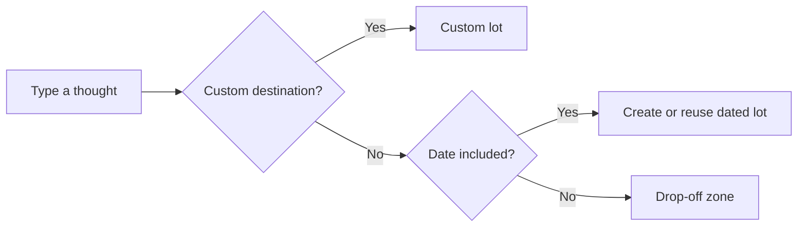

# Natural capture and interface revision

Implemented October 26, 2026 (America/Los_Angeles).

## Behavior

`english outline tomorrow` creates a calendar lot for the next local date and saves `english outline` as its car. Further captures for that date reuse the lot. Undated thoughts default to Drop-off zone. A named custom lot or explicitly chosen destination takes priority. Remembering a destination remains opt-in.

Dates are deterministic and use the device's local calendar. Supported expressions include today, tomorrow, weekdays, named dates, ISO dates, next week/month, and relative days/weeks. Leading weekdays require punctuation to avoid changing names such as Friday Night Lights. Quoted captures and the Keep date in title action preserve literal date wording.

Lot creation, car creation, queued sync mutations, and capture Undo commit together in IndexedDB. Parallel local captures serialize. Calendar IDs are shared across devices; a competing creation adopts the existing server calendar lot while preserving subsequent local edits. Archived calendar lots reopen on reuse. Unrelated conflicts remain explicit.

The development demo initializer no longer relocates existing drop-off thoughts into its sample lot. Existing records and backup formats remain compatible.

## Interface

- Drop-off uses the same pixel parking bays, cars, road geometry, and signs as every lot.
- One floating capture surface holds the destination preview, input, and latest Undo.
- One visible custom-lot creation control replaces the duplicate controls.
- Sync status opens Settings; mobile utilities remain in the navigation menu.
- Today/Tomorrow labels accompany the actual stored calendar date.
- The main heading is visible, scenery is quieter, and obsolete gradient road layers are removed.
- New captures have completion enabled; title clicks edit, and the vehicle action completes. Kind can still be changed to Idea.
- Unfinished capture text survives refresh; custom-lot mode preserves the unfinished thought.

## Verification

- Production build and TypeScript: pass.
- Unit tests: 55 pass, including atomic rollback, repeated dates, simultaneous captures, archived dates, literal dates, parser ambiguity, draft persistence infrastructure, and competing-device calendar creation acknowledgments.
- Worker integration tests: 7 pass against local Miniflare/D1.
- Browser regression suite: 19 of 20 passed initially; the one phone failure identified an empty-composer destination preview issue. After correction, that test passed. All 20 cases have passed across the full run and targeted rerun.
- After consolidating the final capture surface, six affected phone/desktop browser cases passed again (natural capture, strict capacity, and custom-lot creation).
- Additional isolated browser checks at 320, 390, 768, and 1440 pixels verified new-date creation, date reuse, undated drop-off, refresh persistence, no horizontal overflow, and no uncaught page errors.
- Phone coverage uses Chromium emulation, not physical-device testing. Live production deployment and physical cross-device sync were not performed.

## Visual review

The design-taste-frontend app draw selected Editorial greeting, seed 1847775643, retaining the existing palette and type. Its quieter controls and clear first-screen question informed the revision; Parker's map and pixel-art identity take precedence over the generic sheet/grid composition. The screen's question is: where can I put this thought with the least effort? Its signature element is the dated car-park landscape.

Final inspector: zero failures at 1440, 768, and 390 pixels. Two checks are explicitly allowed: rainbow-chart misclassifies the existing SVG landscape as a chart; icon-chips flags actual search/navigation/capture buttons rather than decorative KPI icons. The remaining warnings are intentional: the existing warm paper and green/blue landscape preserve Parker's identity; 11–12px text is confined to secondary sign information. Source lint has zero failures; legacy shadow and sign-in eyebrow warnings remain outside the revised primary flow.

All final fold and page screenshots were visually reviewed. Capture is the clearest action, signs share one treatment, counts derive from stored cars, and phone navigation is folded away. Remaining tradeoffs: the tablet still uses the original single-column map, and secondary sign text is compact. No external pictures, invented testimonials, or new visual dependencies were introduced. Review fixtures are isolated sample thoughts, not production content.
